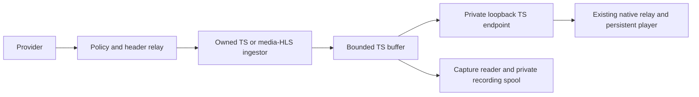

# Architecture

This is a map of the code for someone about to change it, and the rules that
decide where a change goes. [AGENTS.md](../AGENTS.md) has the short form of
the rules; the storage and transport security model is in
[security.md](security.md). The declared native application service boundary
and compatibility policy are in the
[service contract](#internal-application-service-contract-v1).
For task-to-owner links and targeted checks, use the
[contributor map](development.md).

The layers below are the rule for every change. The code does not follow all
of it yet: [Where the code departs from the rules](#where-the-code-departs-from-the-rules)
lists each difference and where the piece goes.

## Contents

- [Terms](#terms)
- [Layers](#layers)
- [Dependency rules](#dependency-rules)
- [Where a piece of code belongs](#where-a-piece-of-code-belongs)
- [Portability](#portability)
- [Crates](#crates)
- [Where the code departs from the rules](#where-the-code-departs-from-the-rules)
- [How the boundaries are checked](#how-the-boundaries-are-checked)
- [Sans-IO ports](#sans-io-ports)
- [State, views and actions](#state-views-and-actions)
- [Recording, parental access and on-demand](#recording-parental-access-and-on-demand)
- [The video layer](#the-video-layer)
- [Shared live inputs](#shared-live-inputs)
- [Import, staging and publish](#import-staging-and-publish)
- [Application runtime and commands](#application-runtime-and-commands)
- [Internal application service contract v1](#internal-application-service-contract-v1)
- [The NSH boundary](#the-nsh-boundary)

## Terms

| Term | Meaning |
| --- | --- |
| Domain | Facts and rules about the content and the viewer's data. They hold for every entry point: a remote, a touch, the bridge, a background refresh, a recording. |
| Operation | Work that achieves a goal: import a playlist, start a recording, resolve a stream. It is the same whoever asks, and it checks its own request. |
| Operation identity | The value that ties a reply to its request. The Application issues it, and it stays unique while the runtime lives. |
| Host capability | A fact a host reports about itself, as a value: its platform, its decoder slots, whether it can record. The Domain's rules read it. |
| Message id | A message named by its English source text, as data, marked with `key`. Only the presentation translates or formats one. |
| Feature | One thing a person operates: the guide, the player's panels, the add-playlist wizard, recordings. |
| Presentation state | What exists only while a person operates a feature, with no toolkit in it. Both front ends share it. |
| State holder | The one type a feature's module is built around. It keeps the feature's state and changes it in one place. |
| Move | What a front end makes of an `Action` for the holder on top: a method call or a holder's own enum (`guide::Move`). |
| Event | What a holder is given: a move, a result the front end took from a runtime event, the time. |
| Effect | What a holder asks for, as a value: tune this channel, start this import, open this prompt. The front end carries it out. |
| Display data | What is shown, computed from a holder, the content, the time and the language by a function with no state of its own. |
| UI element state | State a view keeps for itself and loses on a rebuild: a scroll offset in points, an animation's progress, a hover. |
| Front end | A crate that draws on one toolkit and carries out effects: `iptv-app` (also called the shell) and the bridge. |
| Navigation | Which features are open and in what order, and where Back returns between them. Each front end keeps its own (`ViewMode` and the overlay list in `iptv-app`, `Mode` in the bridge). A holder asks for another feature through an effect. |

Inside a state holder, these words name the fields. They are a vocabulary,
not a reason to split the type:

- **flow step**: where the person is in a task (`wizard::Step`, `parental::Phase`);
- **focus**: which item an action applies to, restored by content identity (`recording::Screen::focus` is a `JobId`, a search result a `ResultId`);
- **viewport**: which part of the content is on screen (`Focus::window`);
- **editable input**: what has been typed or chosen and not yet submitted, with where its errors show (`wizard::FormValues`, `library::details::Form`);
- **operation tracking**: a request in flight (`busy`, `read_generation`, the identity of the import it waits for);
- **interaction policy**: timing rules of the interface (a panel's auto-hide, a held seek key, a digit entry's deadline).

"View model" is avoided: it means the derived value in some architectures
and the holder in others.

## Layers

A layer is defined by the question it answers, and a crate belongs to one
layer. How code builds does not decide where it goes. Plain Rust that
compiles for `wasm32-unknown-unknown` is a constraint several layers share
([Portability](#portability)). Treating it as a layer is how one crate came
to hold the XMLTV parser's byte budgets, the guide's focus rules, the
header's type sizes and the translations.

| Layer | The question it answers | Crates |
| --- | --- | --- |
| Domain | What is true about the content and the viewer's data, and what do the rules allow? | `iptv-core`, `iptv-providers`, `iptv-epg`, `iptv-guide`, `iptv-import`, `iptv-library`, `iptv-search`, `iptv-settings` |
| Adapters | How does one technology do the I/O that a port describes? | `iptv-cast`, `iptv-net`, `iptv-store-sqlite`, `iptv-sqlcipher-init`, `iptv-player-mpv`, the browser adapters of `iptv-web` |
| Application | Which operation runs, in what order, and who owns the result? | `iptv-runtime` |
| Presentation state | While a person operates a feature: what did they ask for, where are they in it, and what is shown? | `iptv-nav`, `iptv-presentation` |
| View | How is that laid out and drawn on this toolkit, which features are open, and who carries out the effects? | `iptv-app` (NSH), the bridge of `iptv-web` |
| Hosts | How is it packaged and started on one platform? | `hosts/android`, `hosts/tizen`, `hosts/tizen-nsh`, `iptv-tui` |

Presentation state and View together are the presentation. A screen is
presentation, not business logic: the business is the Domain's rules and the
Application's operations.

```text
  View                iptv-app                    iptv-web (bridge)
                        │    └──────────────────────────────┐
                        ▼                                   ▼
  Presentation state  iptv-nav            Application   iptv-runtime
                      iptv-presentation                    │
                        │                                   ▼
                        │                 Adapters      iptv-net  iptv-store-sqlite
                        │                               iptv-sqlcipher-init  iptv-player-mpv
                        │                               iptv-cast  iptv-web (browser adapters)
                        ▼                                   ▼
  Domain              iptv-core  iptv-providers  iptv-epg  iptv-guide
                      iptv-import  iptv-library  iptv-search  iptv-settings
```

Presentation state and Application are siblings. Neither can name the other,
and only a front end holds both. The bridge stands on presentation state,
the Domain and the browser adapters, without `iptv-runtime`.

What each layer holds:

- **Domain.** A program's times and whether it is live. Whether a past
  program can be replayed. A channel's content key, a favorites list, a
  parental policy, a recording job, an import's limits. A provider's request
  and the parsing of its response. A pipeline that puts requests in order
  through a port and owns nothing, as the import does, is Domain too
  ([Sans-IO ports](#sans-io-ports)).
- **Adapters.** reqwest and rustls, SQLite and SQLCipher, libmpv, the
  browser's fetch and IndexedDB. One technology each, behind a Domain port
  or a declared contract.
- **Application.** Importing off the UI thread, staging and publishing,
  when a guide is fetched again, the store's lanes, who owns a recording,
  parental admission. It owns threads, connections and results, issues each
  operation's identity, and speaks in named commands and events with its
  own result types
  ([Application runtime and commands](#application-runtime-and-commands)).
- **Presentation state.** `iptv-nav` turns a key and its press phase into an
  `Action` for a `Context`. `iptv-presentation` has one module per feature,
  each around its state holder, with the functions that compute its display
  data, and the localization those functions use: the message catalog,
  plural rules, calendar names and the clock's labels. Both front ends
  share these decisions: `iptv-nav` says what the viewer asked for, and
  `iptv-presentation` what that does to a feature's state. Each front end
  keeps its own routing; the bridge lists its deliberate
  [differences](../hosts/tizen/README.md#differences-from-the-android-tv-app).
- **View.** Views, geometry, type and color on one toolkit. A front end
  turns platform input into keys, keeps the navigation (each front end has
  its own set of features), routes each action to the holder on top, and
  carries out the effects the holders return. `iptv-app` is also
  the composition root: it builds the runtime with its ports
  ([State, views and actions](#state-views-and-actions)).
- **Hosts.** The Kotlin host and Media3 player, the Tizen page and its
  player, the package for each platform, the optional terminal host.

The same shape elsewhere:

- [matrix-rust-sdk](https://github.com/matrix-org/matrix-rust-sdk/blob/main/ARCHITECTURE.md)
  keeps its timeline and room list in a `matrix-sdk-ui` crate above the SDK,
  because clients with no person operating them do not need it, to keep
  compile times down, and so that it uses only the lower crate's public API.
- [Crux](https://github.com/redbadger/crux/blob/master/docs/src/overview.md)
  and [stremio-core](https://github.com/Stremio/stremio-core/blob/development/README.md)
  share a Rust core of state, events and effects under thin front ends. The
  front ends carry out the effects.
- The [Elm guide](https://guide.elm-lang.org/webapps/structure.html) builds
  each module around a central type and warns against splitting state,
  transitions and display into separate modules.
- Android's [state holder guide](https://developer.android.com/topic/architecture/ui-layer/stateholders)
  separates state a holder owns from UI element state, and business logic
  from UI logic.

## Dependency rules

| Layer | May depend on | May use | Never |
| --- | --- | --- | --- |
| Domain | Domain | Plain Rust. Time, randomness and I/O arrive as arguments or through a port. | I/O, a clock, an async runtime, a toolkit, the message catalog, any other layer |
| Adapters | Domain, Adapters | Tokio and reqwest; SQLite. `iptv-store-sqlite` also builds for `wasm32-unknown-unknown` (SQLite through `sqlite-wasm-rs` on in-memory files the host persists in chunks, no SQLCipher); its tests run there with `tools/wasm-test.mjs`. `iptv-player-mpv` uses NSH native components, platform APIs and libmpv; its Android build contains only the wire contract and track parser. | Application, Presentation state, View |
| Application | Domain, Adapters | All I/O through `Ports`. Its default `native` feature holds the native ports (`iptv-net`, threads and Tokio) and the native-only services (recording, the playback relay); without it the crate builds for wasm32. Host JNI and credential brokers stay in the shell. | Presentation state, View, a toolkit |
| Presentation state | Domain | Plain Rust. Time and the language arrive as arguments. | I/O, a clock, Adapters, Application, a toolkit, points |
| Hosts | View and what it composes | A platform's own language and packaging. `iptv-tui` seeds a store for its synthetic playlist. | |
| View | every layer | `iptv-app`: NSH, the runtime and the player wire contract; platform APIs and adapters in `src/host` (`host/native`, `host/web`), with only `main.rs` outside it still holding a platform `cfg` (listed in `tests/app/architecture.rs`). The bridge: a JavaScript host; no NSH, no Tokio, no native adapters. | |

Rules that follow:

1. **One crate, one layer.** A crate that needs code from a second layer is
   two crates. A feature flag or a module name is not a boundary.
2. **One feature, one state holder.** A feature's module is built around one
   type that keeps its flow step, focus, viewport, editable input and
   operation tracking, and changes them together, so each invariant has one
   owner. `recording::Screen::reload` replaces the jobs, puts the focus back
   by job id and dismisses a confirmation whose job is gone, in one step.
   A holder is not split by kind of state, and a module is not split into
   state, transitions and display.
3. **What is shown is computed, not stored.** Display data comes from a
   function of the holder, the content, the time and the language. A fact
   that changes with time, such as whether a program is live, is computed
   when it is shown (`ProgramTiming`).
4. **Effects are values and time is an argument.** A holder does no I/O,
   reads no clock and never calls the runtime. It returns what it wants
   done and says when something is due; the front end sets the timer and
   calls back. Deadlines are on the caller's monotonic clock and program
   times on the wall clock. A timer's callback asks the holder again, which
   ignores a deadline a later event replaced (`ChannelNumber`). A read may
   ask a port for data it lacks, as the stored guide's older days are paged
   in: it records the request and answers with a loading value, and never
   waits.
5. **Application and presentation state meet only in a front end.** A
   runtime command takes Domain values and returns Domain values or the
   runtime's own result types, never a state holder or a form field. The
   front end takes what a holder needs out of a result. A holder keeps the
   identity of the request it waits for and ignores any other reply.
6. **An operation checks its own request.** A form may run the Domain's
   checks early to show an error as the person types. The operation checks
   again when the request is submitted, with what can have changed since
   (an authorization, a source replaced while the request waited), for
   every caller. A failure says in Domain terms which input was at fault;
   the form decides beside which field it shows.
7. **Values cross each boundary.** Below the presentation, a value a caller
   acts on is typed: a failure's kind, a missing listing, why a request was
   refused. A notice that is only shown may be a message id. No layer below
   the presentation translates, formats or compares a message, and a
   provider's own text is passed on unchanged. A front end tells a holder
   facts, not measurements: how many rows fit or that the window is
   compact, as the shell tells `vod::Screen` through `set_compact`, never
   points, a font or a color.
8. **Keys stop at `iptv-nav`.** It turns keys and press phases into an
   `Action` and reads no guide or playback state. A holder takes moves and
   never a key or an `Action`. The `Context` is the one value that crosses,
   and the front end derives it.
9. **Shared code means the same for every caller.** Share the
   classification and let each front end choose its response:
   `ProgramSelection::for_program` classifies OK on a program, and for an upcoming one the
   shell opens its details and the bridge shows when it starts. A host's
   choice enters shared code as a plain value (`ResultPolicy`, the play
   bar's idle delay), never as a test of which host is running. A
   toolkit-free holder is worth having for one front end too: what decides
   is the layer, not the number of callers.

## Where a piece of code belongs

Ask in order. The first yes decides.

1. Does it do I/O with one technology or one platform service: a socket, a
   file, a database, a decoder, a window manager? **An adapter**, or the
   shell's `host` for a platform fact.
2. Does it lay out or draw: the toolkit, points, a font, a color, an
   animation, or state lost on a rebuild? **View.**
3. Is it which features are open, in what order, or where Back returns
   between them? **The front end's navigation.**
4. Must it hold for every entry point: a remote, a touch, the bridge, a
   background refresh, a scheduled recording? A fact, a rule, or a pipeline
   that only describes its I/O through a port is **Domain**. Work that owns
   a thread, a connection, a store or a result is **Application**.
5. Otherwise it exists only while a person operates a feature. What a key
   or a gesture means is **`iptv-nav`**. The rest is the feature's module in
   **`iptv-presentation`**, including what is shared between features, such
   as which kind of input was used last.

Three questions settle a doubtful case: who owns the decision, what must
stay true across every entry point, and when the state expires.

One press through the layers, OK on a program that ended an hour ago:

| Layer | The question | Answered by |
| --- | --- | --- |
| View | Which key did the platform send? | `iptv-app/src/shell/input.rs`: `RemoteKey::Ok`, down then up |
| Presentation state | What did the viewer ask for? | `iptv-nav`: a short press in `Context::Guide` is `Action::Select` |
| View | Which feature is on top? | `input.rs` routes the action to the guide |
| Domain | Can this program be replayed? | `Program::can_replay`, from its start, now and the channel's archive days |
| Presentation state | What kind of selection is this, given what is playing? | `ProgramSelection::for_program`: `ProgramSelection::Replay` |
| View | What does this front end do with a replay? | `iptv-app` asks the runtime for the stream and changes the view mode |
| Application | Which stream is that, and may it play? | `iptv-runtime`: the archive stream, with a provider round trip where one is needed, after the parental check |
| Adapters | How is it fetched and decoded? | `iptv-net`'s loopback relay; `tv.player` |
| View | What does full screen look like here? | `iptv-app`: the same player laid out full screen, the card over it |

## Portability

Portability is a build constraint, not a layer. Domain and presentation
state crates must not depend on NSH or platform APIs, must not block, and
must build for `wasm32-unknown-unknown`.

On Linux, `tools/check.sh` builds every portable crate for
`wasm32-unknown-unknown` (the `PORTABLE` list in `tools/ci/check-plan.py`).
That build is what keeps platform code out of them. For the browser build of
the application stack ([Tizen NSH host](../hosts/tizen-nsh/README.md)) it also
runs the runtime's unit tests without its `native` feature and lints for
wasm32 the runtime without it, the shell with its web host, iptv-web's
adapters and the Tizen runner.

A browser TV runs the same shell and runtime as every other platform: the
application stack is built for the browser, not rewritten for it. A port is
added only where two implementations exist. Adapters execute and do not
decide: refresh timing, list building, admission and retry policy stay in the
portable crates or the runtime. In either Tizen package, JavaScript draws and
performs platform I/O; the bridge's page also handles setup, the keyboard and
the app lifecycle.

## Crates

The workspace has nineteen crates under `crates/` and the vendored
`nsh-tv`. [Dependency rules](#dependency-rules) govern their dependencies.

| Crate | Layer | Depends on (workspace crates) |
| --- | --- | --- |
| `iptv-core` | Domain | none |
| `iptv-settings` | Domain | none |
| `iptv-providers`, `iptv-epg` | Domain | `iptv-core` |
| `iptv-guide` | Domain | `iptv-core`, `iptv-epg`, `iptv-providers` |
| `iptv-search` | Domain | `iptv-core`, `iptv-epg` |
| `iptv-library` | Domain | `iptv-providers`, `iptv-epg` |
| `iptv-import` | Domain | `iptv-core`, `iptv-providers`, `iptv-epg`, `iptv-settings`, `iptv-library` |
| `iptv-nav` | Presentation state | none |
| `iptv-presentation` | Presentation state | `iptv-core`, `iptv-epg`, `iptv-library`, `iptv-providers`, `iptv-search`, `iptv-settings`; `iptv-guide` for tests |
| `iptv-cast` | Adapters | none |
| `iptv-net` | Adapters | `iptv-providers`, `iptv-import` |
| `iptv-store-sqlite` | Adapters | `iptv-core`, `iptv-providers`, `iptv-epg`, `iptv-import`, `iptv-library`, `iptv-sqlcipher-init` (native only) |
| `iptv-sqlcipher-init` | Adapters | none |
| `iptv-player-mpv` | Adapters | `iptv-core`, `iptv-net`, platform NSH components |
| `iptv-runtime` | Application | `iptv-core`, `iptv-epg`, `iptv-guide`, `iptv-import`, `iptv-library`, `iptv-providers`, `iptv-search`, `iptv-settings`, `iptv-store-sqlite`; `iptv-net` with its `native` feature |
| `iptv-web` | Adapters, and with its `bridge` feature View | `iptv-core`, `iptv-epg`, `iptv-guide`, `iptv-import`, `iptv-providers`, `iptv-search`; `iptv-nav` and `iptv-presentation` with `bridge` |
| `iptv-app` | View | every portable crate, `iptv-runtime`, `iptv-player-mpv`, `nsh-tv`, NSH; natively `iptv-net`, on desktops and handheld Android `iptv-cast`, on Apple hosts AVKit and AVFoundation, in the browser `iptv-web` and `iptv-store-sqlite` |
| `nsh-tv` (vendored) | View | NSH |
| `iptv-tui` | Hosts | `iptv-app`, `iptv-library`, `iptv-net`, `iptv-player-mpv`, `iptv-providers`, `iptv-settings`, `iptv-store-sqlite`, NSH |

What each crate owns:

- `iptv-core`: the values and rules more than one crate needs. Guide time,
  `Program` and the `Schedule` trait, lists by content key, organization,
  parental policy, recording jobs and rules, on-demand values, the
  add-playlist request and the import's report, player states and errors,
  tracks, host capabilities, import limits, message ids.
- `iptv-providers`: M3U, Xtream and Stalker clients mapped to one model, with
  stable content ids and credential types that redact themselves.
- `iptv-epg`: the incremental XMLTV parser, channel matching, and compact
  per-channel schedules.
- `iptv-guide`: the guide schedule built from imported channels and the EPG
  store, behind the `Schedule` trait of `iptv-core`, and stream resolution.
- `iptv-import`: the import pipeline that drives the two above, its ports,
  and when a stored guide is downloaded again.
- `iptv-search`: text folding, the channel and program indexes, and search
  history.
- `iptv-library`: playlist and guide identifiers, policy and list models,
  guide edits and repair values. SQLite re-exports its former model paths.
  Guide feed IDs are `iptv_epg::FeedId`; playlist IDs are
  `iptv_library::SourceId`.
- `iptv-settings`: one declarative schema that drives storage, backup,
  validation and the settings tree.
- `iptv-nav`: remote and keyboard input. Key events become short or long
  presses, and a keymap resolves them to actions for the current context.
- `iptv-presentation`: one module per feature, each around its state holder
  with its focus held by content identity: the guide, the player's panels
  and play bar, menus, the channel list, multiview and picture in picture,
  the wizard, search, the playlists and guide sources, recordings,
  on-demand, parental entry, settings. Also their display data and the
  localization: interface languages, the message catalog, plural rules,
  calendar names and the clock's labels.
- `iptv-cast`: native discovery and control of Google Cast and AirPlay
  receivers.
- `iptv-net`: the native network client (reqwest with rustls), the loopback
  playback relay and recording capture.
- `iptv-store-sqlite`: the encrypted catalog, guide and user data, staging
  and publishing.
- `iptv-player-mpv`: the `tv.player` contract and its libmpv implementation.
- `iptv-runtime`: the application services and the state they own.
- `iptv-app`: the NSH front end and composition root.
- `iptv-web`: the bridge, the supported app on Tizen 5.5.

The shell's platform code lives in `iptv-app/src/host`: `host/native`
(desktops, iPad, Android: key stores, private directories, OS recording
schedulers, the libmpv components, the local time zone) and `host/web` (a
browser TV, over `iptv-web`'s adapters: the page's fetch, the cooperative
executor, and the browser store on IndexedDB chunks in `host/web/store.rs`,
the one shell file that names the store adapter). `hosts/tizen-nsh` builds
the shell for Samsung TVs on the external NSH platform nsh-platform-tizen
(its own workspace and lockfile, built by its `build.sh`). Screens ask the host's facade (`crate::host`) for platform facts
instead of using `cfg`; `iptv-app/tests/app/architecture.rs` lists the files
that still have one. `iptv-tui` runs the same shell in a
terminal on nsh-platform-tui; it is built in CI and not packaged.

`iptv-web`'s bridge is the app for TV web runtimes, where NSH's web
runtime cannot run (Samsung Tizen; see [hosts/tizen](../hosts/tizen/README.md)).
It runs the portable import, guide and list models in WebAssembly inside a
Web Worker: its `Fetch` adapter hands each request to the worker's
JavaScript, and a small executor polls the import after every delivery. The
page renders the views it emits, sends remote keys and plays streams with
the TV's native player. Its stored guide is an `iptv-epg` snapshot
(`GuideStore::to_snapshot`) rather than the SQLite store. Without its
`bridge` feature the crate is only the browser adapters, which is how
`iptv-app`'s web host takes it.

`iptv-sqlcipher-init` is the narrow native FFI boundary for the pinned database
library. It completes SQLite core initialization, invokes SQLCipher's idempotent
extra hook, then probes a fresh connection for the export auto-extension before
allowing store connections. Failed initialization stays an error; only successful
process readiness is cached, with no key, storage path or application owner.
The store crate denies unsafe code outside its browser VFS (`browser.rs`). Readers,
staging databases, private files and legacy snapshot conversion use the same
initialization boundary.

## Where the code departs from the rules

These departures remain.

| What | Where it is today | Rule | Where it goes |
| --- | --- | --- | --- |
| A lookup that reads a file | In a browser package the first lookup of a language reads a package file inside `translate`, and a failed read stays an empty catalog | 4 | The host loads a language's catalog and hands it in; `translate` only looks up. |
| Untyped message IDs | `key` marks a string in `iptv_core::message`. Its type also admits unmarked sentences. | 7 | A typed message ID. |
| One crate in two layers | `iptv-web`: browser adapters, and behind `bridge` the bridge | 1 | Two crates, with one owner for the wasm entry points both workers call. It waits for the decision on the bridge's future. |

Exceptions that stay, each with its reason:

- **The bridge has its own small application.** It does not use
  `iptv-runtime`: its import, guide refresh and stored snapshot are a few
  modules of `iptv-web` (`app`, `store`). It stays while the bridge is the
  supported app on Tizen 5.5 and retires with it.
- **`iptv-player-mpv` names NSH.** The player is a native view, so its
  adapter registers a toolkit component. The crate also declares the
  `tv.player` contract the shell and the Kotlin host follow
  ([The video layer](#the-video-layer)).
- **`iptv-app` holds host code.** It is the composition root, so it names
  adapters and platform APIs, inside `src/host`. Its browser host names the
  store adapter in one file, `host/web/store.rs`.
- **`iptv-tui` seeds a store directly.** It is an optional host for a
  synthetic playlist, not a second application.

## How the boundaries are checked

| Rule | Check |
| --- | --- |
| No cycles; a crate names only what its manifest lists | Cargo |
| Each workspace crate depends only on its allowed layers, and only the front ends depend on `iptv-presentation` | `tools/ci/test-layers.py` reads Cargo metadata, including dev, target-specific, renamed and optional dependencies |
| Only the bridge feature of `iptv-web` can name a state holder | `tools/ci/test-layers.py` enforces the feature edge, and the adapters-only wasm check builds without it |
| The portable crates compile for wasm32 with no platform crate | the wasm32 builds ([Portability](#portability)) |
| The runtime depends on and names only its listed crates, and no toolkit, shell or player | `iptv-runtime/tests/it/architecture.rs` |
| The shell names only the listed runtime items and no store type; runtime events enter at one place | `iptv-runtime/tests/it/shell_boundary.rs` |
| In the shell, only `host/web/store.rs` names the store adapter; platform `cfg` and the clocks stay in the host modules; the shell's statics are listed | `iptv-app/tests/app/architecture.rs` |

The lists in those tests are exact: a new name fails until it is added on
purpose, and an unused entry fails until it is removed.

## Sans-IO ports

The portable crates never perform I/O. They describe it, and an adapter does
it. There are three kinds of port.

**Requests as values.** A provider client in `iptv-providers` builds an
`HttpRequest` and parses an `HttpResponse`. It never sees a socket.

**`Fetch`** (`iptv-import/src/fetch.rs`) is the network boundary of an import:

- `fetch(request)` sends a request and reads the whole body;
- `fetch_stream(request)` returns once the status is known and yields the body
  in chunks, for large playlists and XMLTV files;
- `elapsed()` is the adapter's monotonic clock, for an end-to-end deadline.

The adapter owns transport policy: TLS, timeouts, redirects, decompression.
`iptv-net`'s `NetClient` is the native implementation (reqwest with rustls);
tests use an in-memory fake. The trait does not require `Send` futures, so a
single-threaded web adapter would fit as well.

**Sinks** are where an import puts its results, so nothing large is held in
memory:

- `CatalogSink`: catalog rows (groups, channels, films, series) as they are
  parsed, in steps that succeed or fail as a whole;
- `GuideSink`: one feed's programs as they are parsed, with `finish_feed`
  or `discard_feed` at the end;
- `ProgressSink`: progress events for the import screen.

A `CancelToken` stops an import between requests, between chunks and while a
request is in flight. Time is a port too: every time-dependent function takes
`now` from its caller, which is why tests need no real waits.

## State, views and actions

State has four lifetimes, and each has one owner.

| State | Examples | Owner | Lasts |
| --- | --- | --- | --- |
| The content and the viewer's data | the catalog, the guide, favorites, settings, recordings | Application: `iptv-runtime`, stored through an adapter | across a restart |
| An operation in progress | an import, a guide refresh, a recording | Application | until it completes |
| Presentation state | the focused program, the open panel and its timer, a wizard's step and its input | the feature's state holder, held by the front end | while the feature is open, across view rebuilds |
| UI element state | a scroll offset in points, an animation's progress, a measured size | the view | until a rebuild |

The runtime owns durable data and operations. The front ends hold their
feature state in `iptv-presentation` holders. Views render that state and
send actions.

1. **Input.** NSH reports a keystroke. `iptv-app/src/shell/input.rs` turns it into an
   `iptv_nav::RemoteKey` with a phase, a `PressDetector` decides short or long,
   and `Keymap::resolve` maps it to an `Action` for the current `Context`
   (guide, full screen, a menu, an editor).
2. **State.** `input::apply` applies the action to the app state. That state is
   the `Ui` struct in `iptv-app/src/ui.rs`: NSH signals grouped by area, many of
   them holding a state holder (`Focus`, `ChannelList`, `Panels`, `Menu`, and so
   on). The transition itself is a method of the holder, so it is tested
   without a UI.
3. **Effects.** A holder answers with an outcome or an effect as a value
   (`browse::Outcome`, `panels::Pick`, `WizardEffect`). The front end carries
   it out: it tunes, sends the runtime a named command, or opens another
   feature. The runtime's results come back as events at
   `runtime_events::apply`, and the front end hands them to the holders as
   values.
4. **Views.** Each region (header, rail, groups, grid, player panels) reads the
   signals it needs and re-renders when they change. Views hold no state of
   their own that matters after a rebuild.

Focus is restored by content identity, never by list index. A list can be
re-sorted, filtered or refreshed between two frames, so the state remembers
*which* channel or search result was focused. The last played channel is
saved the same way, by its content key.

The scenario tests in `crates/iptv-app/tests/app/` run this whole loop
headless, with the synthetic fixtures, each in its own process.

## Recording, parental access and on-demand

Recording jobs live in `iptv_core::recording`, with the repeating rules of
earlier versions, kept only so they can be read, listed and retired. The remote and
touch screen model lives in `iptv_presentation::recording`. The app's
`recordings_view` renders it and calls the `iptv-runtime` recording service. SQLite stores durable,
source-scoped intent without resolved stream URLs. A scheduler conditionally
claims the saved time window, so cancellation invalidates an old read. Jobs are host-local and are removed from portable snapshots/restores.
Snapshots also drop downloaded guide programs and mark each stored guide as
never downloaded, so the restored app fetches the guide at its first start.

Recorders write MPEG-TS independently of rendered players, using the playback
relay for every upstream request and adaptive child. The runtime reserves
connections before recording or changing a viewing surface, retaining an
active lease's account identity across playlist edits
([shared live inputs](#shared-live-inputs) covers sharing a connection and the
budget for unknown account associations). Retries retain a surface's existing
reservation; desktop PiP reserves no additional provider connection.

Media is private but unencrypted in a `-recordings` sibling of the catalog
directory, excluded from OS backups and untouched by catalog directory
swaps. Playback uses a read-only random-capability HTTP server with byte-range
support, so both native player hosts keep their guarded HTTP path. Deletion
refuses the file currently playing. Interrupted jobs recover captured media
as partial recordings; publication never overwrites an existing media file.
Native recording ownership is independent of the UI service epoch. A host
shares recording state and account budgets across engine recreation while a
process-wide storage lock excludes competing processes. Android supplies a
sticky foreground service and a wake lock while a capture runs; a desktop
holds the computer from idle sleep. Nothing registers a login item, a wake
timer or a boot receiver, and iPad background capture is not implemented.
Accepted jobs do not depend on viewing unlocks.
Independent UI and recording services share per-directory filesystem gates
for private playlist publication and recovery, so opening one service cannot
remove another service's active encrypted temporary file.

Retained-media playback reports source-token-scoped timelines and numbered seek
acknowledgements. Seeking preserves the player surface and pause state; stale
observations cannot undo a newer seek. Recording and on-demand resume metadata
live in the encrypted catalog, independently of retained media bytes.

Parental policy and unlock scopes live in `iptv_core::parental`. The PIN
dialog state lives in `iptv_presentation::parental`.
The native runtime stores salted one-way PIN/recovery verifiers, durable attempt
backoff and source-qualified blocks. Provider/category membership is checked
from current storage at native admission, with final grant checks before
handing resolved streams to the decoder. Suspending a mobile player requires
fresh shell authorization before it can open its retained URL again.

The on-demand catalog renders source/content identities, provider details,
seasons/episodes and persisted progress. Temporary provider links are resolved
again on retry; source-incarnation checks reject stale detail/progress work
following source deletion and recreation. These native recording, parental
and VOD APIs remain experimental outside
[runtime contract v1](#capability-and-compatibility-policy).

## The video layer

There is one persistent player surface under the UI
(`iptv-app/src/playback/video.rs`). It is a native component named `tv.player`:

- on Android the Kotlin host (`hosts/android`) registers it, on Media3;
- on Linux, macOS, iPad and Windows `iptv-player-mpv` registers it, on libmpv.

Both sides implement the same contract of props (`source`, `paused`,
`pictureSize`, track choices, volume) and events (`state`, `size`, `error`,
`position`, `tracks`), summed up at the top of `video.rs`.

The contract is declared once, in `iptv-player-mpv`. `props.rs` names each
prop and nested field with its wire name; the serialized snapshot, the shell's
typed bindings and the names the shell and the mpv adapter use are all
generated from that declaration. `events.rs` holds the typed `PlayerEvent`
that the mpv adapter writes and the shell reads from either host. The Kotlin
host keeps its names in one file (`PlayerContract.kt`), and two synthetic JSON
fixtures (`iptv-player-mpv/fixtures`) hold the hosts together: the Rust tests
read and write them exactly, and the Kotlin test hands every fixture prop to
`setProp`, failing on a name it does not know, and compares every fixture
event with what the host emits. The shell supplies the playback transport
policy when registering the player.

The invariants:

- **Modes change layout only.** Guide preview, full screen and overlays are
  the same player laid out differently. Changing mode never recreates it.
- **Never hide, detach or re-parent the player view.** On Android that
  destroys its video surface. A surface with nowhere to show shrinks to
  nothing instead.
- **Multiview** adds one more `tv.player` per further tile while it is open
  and drops it when the tile goes. Surface 0 stays.
- **Picture in picture on the desktops** shows surface 0's player in a second
  window through the `tv.pip` view. There is no second player and no second
  stream (`mpv/pip.rs`).

Players never receive provider credentials. Each player talks to a loopback
relay in `iptv-net` (`playback.rs`), which fetches the stream, its redirects
and its HLS or DASH subresources, and scopes identity headers to the stream's
origin. Android reaches the same relay through JNI (`android_transport.rs`).

`player.rs` drives playback: it resolves a channel to a stream, feeds it to a
surface, and runs the health machine, `iptv_presentation::playback_health::Health`
(retry with backoff, stall detection, the error and waiting overlays).

## Shared live inputs

Patina can watch and record a direct MPEG-TS stream or an unencrypted
MPEG-TS HLS **media playlist** through one incoming owner. Provider requests
come from one ingestor; HLS manifest reloads and segments are fetched sequentially,
without a second playback/capture downloader.

Adaptive/master HLS playlists retain native variant selection. Encrypted HLS,
fMP4, DASH and external audio/subtitle renditions retain native playback through
an owned HTTP passthrough relay. The relay preserves all variant choices and
request policy; it does not make these transports shareable with capture.
Recording uses its existing independent transport when a separate connection
is permitted. A preparation probe closes and acknowledges upstream retirement
before native fallback opens. HTTP VOD and catch-up playback use the same owned
passthrough lifetime, so a later live probe cannot overlap their retired owner.

Non-HTTP native transports retain their original player path. While handing off
from such an unowned provider transport, Patina avoids speculative shared-input
probing and publishes the independent path after ordinary admission. A saved
local recording is not a provider transport and does not suppress a live probe.



### Ownership and admission

Portable `iptv-core::live` values define source incarnation/channel identity and
count unique incoming connection IDs. Runtime admission additionally checks the
source configuration, final resolved URL and headers, and complete transport
trust policy. Numeric source IDs, matching channel text, or matching addresses
alone grant no sharing authority. Imported schedules retain an opaque,
nonserializable source incarnation/configuration snapshot. Resolution binds the
original channel before portal I/O. Preparation compares that origin after the
surface gate and again before publication; edits reject stale results instead
of rebinding credentials or account budgets. Selection searches all ready
owners using the complete resolved URL, headers and trust policy.
Viewing and capture use the same
local-offset clock helper. Naturally rotating live URL templates, refreshed
links, changed authentication/format context or changed trust policy may no
longer match an existing input; those cases require the permitted independent
fallback rather than weakening URL/header equality.

The runtime registers an incoming ID with its original account lease before
starting provider I/O. Pending preparation, playback and capture references use
that same ID. Registered owners remain budgeted through cancellation and
acknowledged upstream closure, even if a surface switches to another account,
a recording finishes, a claim fails, or its UI disappears. A closing owner cannot
acquire new consumers. Replacement may plan to retire its sole old viewer owner;
actual replacement I/O waits for that retirement. Rejected selections do not
cancel or revise an already admitted preparation.

A recording retains its own reader and incoming lease. Stopping playback or
zapping releases only viewing ownership. Returning to a still-recorded channel
can reuse that incoming owner. Other channels and unsupported transports require
their own permitted connections. Streams with unknown account association, M3U
ones included, conservatively share a budget while they own a connection. An
idle M3U playlist does not lower a known account's allowance merely by being
stored in the library.

Android/background-capable hosts run preparation and ingestion on the recording
host executor. UI-engine teardown cannot destroy that executor or its capture.
Suspended native players retain an incoming owner only while a capture needs it;
retained suspended owners remain counted. A native resume whose old local
capability retired uses the normal playback retry path.

### Bounded media behavior

The ingestor aligns output to complete 188-byte TS packets. Its shared rewind
buffer is bounded to 4 MiB; one HLS segment uses the existing recorder's 32 MiB
validation limit. A segment's packets reach consumers as they arrive, so the
input is ready, and the player opens, with the live edge's first packets rather
than after its whole segment. The segment's body is always read to its end into
a queue bounded by that limit, so consumers that pause cannot leave the
provider's response open until its read timeout. Consequently a segment that
fails validation partway (lost sync, a torn final packet, over the limit, a
dropped connection) may already have delivered some of its earlier whole packets
to every consumer, shared captures included, before the input ends; packets
still queued when it fails are dropped. A capture that owns its connection
still writes whole segments only. When a stream's first segment fails that way
after the player opened its first packets, the failure is recorded before the
player sees the input end, keyed by source, source incarnation and channel (not
the provider URL, whose token may change on every resolve). One segment over
the limit, or two that failed their checks (a single torn final packet may be a
connection cut short), send the stream to its provider's own transport for
30 minutes from the failure: the player's retry plays it that way, as a stream
refused before its first packets does at once. A first segment that validates
clears the stream's earlier strikes, and network failures never count; a changed source
incarnation or configuration forgets its streams, and at most 256 are kept,
the oldest forgotten first.

The most advanced consumer governs read-ahead: ingestion pauses once its unread
window reaches 2 MiB. Advancing capture continues while playback
is paused, and advancing playback continues when a capture stalls. If every
consumer stalls, ingestion pauses. A consumer behind the retained window receives
an explicit gap; bytes are never silently skipped. Live provider pacing is preserved. Synthetic
finite inputs used for native validation are throttled at their upstream server.

A late capture starts at the current cursor, with at most 512 KiB of exact TS
pre-roll from the most recently received PAT start. That interval is used only
when its PAT arrived within two seconds of attachment; it can contain a short
pre-attachment program interval. It preserves packet ordering and section
continuations. A multi-section PAT/PMT may finish only as live input continues;
Patina does not synthesize tables or claim readiness from a PAT alone. If no
bounded recent interval exists, the reader continues at the live edge and receives
subsequent program tables naturally.

Starting or stopping capture never changes the player's source, load token,
view placement or native surface. Capture uses the existing secure spool writer
and recording finalization path. Synchronous writes cannot race finalization
when capture is canceled. A shared stream ending or skipping before its stop
or deadline finalizes retained complete packets as Partial (or Failed with no
media). It does not silently switch to an independent capture that would consume
the viewer's only connection; playback can retry a fresh shared input.

### Synthetic verification

The transport tests cover authenticated generated TS/HLS request and active
connection counters, capture ownership after playback drop, capture stop,
bounded lag, paused-playback capture progress, reader lifetime, preparation
cancellation, unsupported-probe retirement, and bounded current PAT intervals.

Runtime tests cover immediate replacement peak connection count, distinct-account
pending cancellation, source reincarnation, auth-context mismatch, capture stop,
shared failure followed by fresh playback, suspended sharing, UI executor teardown,
and native master-playlist fallback with independent capture admission. Native
validation must additionally exercise the unchanged Apple, Android and desktop
player adapters and their persistent surfaces. Only generated local media and
isolated application data are used.

## Import, staging and publish

An import never writes to the live catalog while it downloads.

1. **Stage.** The runtime starts the import off the UI thread. It creates a
   `CatalogStage`, a private scratch database opened through the store so that
   it is encrypted with the same key. `iptv_import::import_source_into` streams
   rows into it through `CatalogSink`.
2. **Publish.** Only when the whole import has passed does
   `Store::replace_catalog_stage` copy the stage into the store, in one
   transaction. Readers see the old catalog or the new one, never a mix.
3. **Guide.** The EPG works the same way: `import_epg` streams programs into
   an `EpgStage` (its own file, written by its own thread in bounded batches),
   and `Store::replace_epg` publishes it in one transaction.

A failed or canceled import publishes nothing: the stage is dropped and its
file deleted, and a new source is stored only once its first import succeeded.
A crash can leave a stale stage file, which is removed at the next start. A
stored source's channels and guide are on screen before its refresh reaches
the network, and stay when the refresh fails. Whether a stored guide is
downloaded again is decided by `iptv_import::plan_startup` from the
`epg.update_*` settings.

## Application runtime and commands

`iptv-runtime` is the application layer. It builds and tests without
NSH or the player. The shell holds one `Rc<Runtime>` and installs a task host, timers
and an event sink. Runtime events enter the shell at
`runtime_events::apply`; views issue named commands rather than closures
that can reach a `Store`. `iptv-runtime/src/model.rs` exposes command values, without
exposing the connection or worker API. Early playback receives a runtime-owned
`PlaybackChannel` containing the provider channel and its parental block, rather
than a storage row. Native library snapshots, import metadata, store errors and
stored feed configuration remain behind private implementation surfaces.
`DatabaseKey` is the one adapter-owned boundary exception: the platform credential
broker supplies this opaque, redacting key through `Ports`; commands return no
adapter-owned values. Compile-checked contracts cover every public command result,
including inferred values and aliases, and compile-fail examples keep native
snapshot and planning helpers private.

Runtime owns the current schedule, library snapshot, refresh tickets and
attempts, combined-source parts, guide status, favorites, search indexes,
backup progress and settings. Its services own the store lanes, bounded
refresh pool, file writer and shared two-worker Tokio executor. Refresh
scheduling consumes foreground notifications and emits refresh requests;
it does not wake a sleeping device. Platform handles, caches and UI gesture
flags remain in the shell, with an explicit list in
`iptv-app/tests/app/architecture.rs`. The boundary is a set of exact lists
that only change on purpose: `iptv-runtime/tests/it/architecture.rs` lists the
crates the runtime may name, the runtime modules that may name the store
adapter, and its few process-lifetime statics (no thread-local);
`iptv-runtime/tests/it/shell_boundary.rs` lists what the shell may name from the
runtime, and keeps store types and the store dependency out of the shell.

The runtime has no ambient owner. Every operation is given the `Runtime` it
acts for, and that owner's fields are private behind methods named for what
they do. Work that leaves the UI thread carries a `Send` handle to its
owner's services (store lanes, file writer, executor, refresh pool, settings,
ports) taken when the work was accepted, with the application epoch of that
moment. A late reply therefore keeps its owner's settings, paths and epoch;
it cannot adopt a newer application's state, and constructing or starting
another `Runtime` changes nothing an open owner can observe. Closures kept
inside an owner's own state (a schedule's page loader and description
lookup) hold it weakly. Android's off-thread `onStop` callback flushes
through a `HostHandle` the application root registered in the shell; it
does not keep the owner alive. Teardown drains accepted writes, rejects
later work and cancels imports and link resolves.

Closing has two phases. An epoch-bound token first closes admission, so
owner-bound queries see the closure at once. Writer jobs already accepted keep
their epoch until the writer's FIFO barrier closes it, so a dropped reply does
not discard accepted persistence. A restart installs a new token and epoch;
old handles stay closed. Hosts drain explicitly (`Runtime::drain_services`).
Dropping a runtime that was not drained attempts the same for its own lanes,
within one ten-second deadline, and then waits up to two seconds for accepted
small-file writes, so that SQLCipher's process cleanup does not run under an
open connection. An explicit attempt spends that budget once, even if it timed
out. A timed-out or noncooperative worker is not guaranteed closed, and the
failure is logged without paths or credentials. The recording host keeps its
own services and continues after the UI owner is gone; an explicit desktop
Quit closes the window only after the recording host has shut down.

The private store service owns two long-lived connections to the encrypted
catalog. The writer serializes mutations, staging and reads that must
follow queued writes. The read-only connection serves guide, search and
organization queries without waiting behind a publish transaction. Both
are lanes of the owner's execution port, natively dedicated threads; no
SQLite operation runs on the UI thread there.
Each owner has its own pair. Each request carries its application epoch.
Recursive requests to the same worker and requests from a retired owner are
rejected.

Imports use the bounded refresh pool so their blocking store waits cannot
hold Tokio's network workers. Channel indexing and organization preparation
run off the UI thread. The final `EpgSchedule` wraps prepared data and local
callbacks on the UI thread, retaining its `Rc` model. The storage prerequisite
measured the expensive preparation at 100k channels; no `Rc` to `Arc` rewrite
is needed for that work to leave the UI thread.

The shell constructs `Runtime::new(Ports)` with its private directory,
credential-key callback, OS backup-exclusion hook and startup instrumentation.
`Ports` is also the runtime's whole I/O boundary: `network` makes the
clients (`network::Client`, an `iptv_import::Fetch`) for imports, browsing,
link resolves, staged probes and artwork; `execution` supplies the store
lanes, long-lived workers (the refresh pool, the file and favorites writers)
and each owner's task executor; `entropy` gives random bytes. The runtime
reads time through `iptv_runtime::time` (the system's clocks natively, the
host's in a browser build). The native adapter module implements `Ports::new`
using `iptv-net`, threads and a two-worker Tokio runtime per owner, and the OS
random source. Browser hosts pass their network, executor and entropy
implementations to `Ports::with_adapters`.
`execution::Cooperative` is the browser's: one thread, lanes run in turns of
the host's event loop, a blocking request runs its lane's queue inline, and a
`Sliced` job (a resumable publish) runs at most one step per turn, the rest of
the turn going to the other lanes' reads. It has no workers,
so the services built on them report themselves unavailable, and staged
probes, whose workers block, are refused. Where the host keeps the store
itself (`Ports::store_host`, the browser), the runtime opens and persists it
through that port, runs catalog and guide publishes as `Sliced` jobs on a
publish copy (`publish.rs`: reads continue on the last commit between
200-row steps, writes wait for the swap), and runs imports and guide
downloads as tasks, one at a time (`Services::submit_import`). Only `native` modules may name
`iptv-net` or start threads and Tokio runtimes
(`iptv-runtime/tests/it/architecture.rs`).
Native workers capture those inputs with their accepting service. JNI entry
points and credential-broker implementations remain in the shell. The host's
local task executor and timers are installed separately through `bind_tasks`.
The shell retains the one handle (`crate::runtime()`) and passes it to every
runtime call. A local task polls with the owner that accepted it, also after
the root was recreated: that scoping, and its restoring on unwinding, live
in the shell (`in_runtime`), not in the runtime. Local controllers use
explicit state accessors; store connections, writer queues and native
service handles remain private.

Run `cargo test --locked -p iptv-runtime` to test application services without
linking a display toolkit or reaching an OS credential broker. Public-API tests
cover suspended task delivery, a second owner constructed, started and closed
beside an open one, per-owner settings and small files, owner lifetime, and
requests keeping their accepting private directory and key broker on another
thread.
Scenario processes stay isolated because NSH and the player have their own
platform globals.

## Internal application service contract v1

Status: **stable internal service contract v1**. This section versions
application semantics independently of the package version. It describes the
boundary used by Patina's UI and an independent native test consumer. It
establishes no binary ABI, external SDK or MCP wire-schema promise.

### Public boundary and ownership

The supported foundation boundary consists of `iptv_runtime::Runtime`'s query,
inspection and repair methods listed below, portable value/error types in
`iptv_library::inspection` and `iptv_library::guide_repair`, and the runtime's
inspection request/control types. Native hosts construct an owner using `Ports`,
start its services, supply task/event ports where orchestration requires them,
and drain/retire that owner on shutdown. The credential port's
[`DatabaseKey`](#application-runtime-and-commands) is an explicit construction
input; it is not a query record.

The application shell imports `InspectionControl`, `ProbeRequest`, `ProbeTarget`
and `ProbeLease` through `iptv_runtime::model`. Their existing
`iptv_runtime::inspection` paths remain supported by the v1 contract.

The Android recorder installs a callback through `Ports::recording_failed`.
It receives only the `RecordingFailure` category for a capture belonging to
that runtime.

Keep the owner on its application thread. Local futures and `Rc` state have no
general `Send` guarantee. Work that leaves the thread carries captured services
for its accepting owner/epoch
([Application runtime and commands](#application-runtime-and-commands)). A new
owner cannot redirect old work to its storage, keys, settings or callbacks. Tests invoke these services without an
NSH root, view, player, endpoint or daemon.

Store adapters, SQL rows/connections, staging databases, task executors and
presentation indices are implementation details. Existing helpers outside the
listed boundary remain experimental. A public type alias or inferred return
type does not permit a store record to cross the declared boundary. Views
use the boundary as [State, views and actions](#state-views-and-actions)
describes.

### Queries and EPG inspection

| Runtime method | Result and meaning |
|---|---|
| `inspect_channel` | One source-scoped channel or a typed missing/access/storage outcome |
| `query_channels` | Bounded semantic page matching explicit source scope and text/visibility filters |
| `query_programs` | Bounded program page in a supplied UTC interval, optionally for one channel |
| `epg_audit` | Coverage/diagnosis over an explicit interval; schedule coverage never proves broadcast identity |
| `epg_candidates` | Configured-feed alternatives and matching evidence without mutating automatic choices |
| `probe_feed` | Bounded inspection of a configured or supplied feed into disposable private staging |
| `probe_candidates` | A bounded page from the exact staged channel index |
| `probe_schedule` | Bounded program samples from the exact retained snapshot for a candidate |

Requests select one source, selected sources, or all enabled sources explicitly.
There is no implicit shown-source fallback. Reading another source changes no
shown schedule, browsing focus, playback session or player surface. Disabled
explicit sources fail distinctly; all-enabled scopes omit disabled sources.
Hidden content is a visibility preference. Blocked content follows runtime
access policy and cannot be reached by bypassing search with a known ID.
Native PIN/unlock behavior is implemented by the parental service. Direct-ID
playback queries enforce its current policy and source membership; grants are
revoked on lock and owner retirement. The administrative parental API remains
experimental outside this versioned query/repair contract.

Channel identity is `(SourceId, ContentId)` within its current catalog context.
Names, list positions and physical row IDs are not identities. Source deletion,
recreation and restore invalidate retained authority; IDs alone do not promise
continuity across those events. Source/feed incarnations distinguish reused
numeric IDs. Program references preserve channel/feed provenance, source
incarnation, evidence revision and observed interval; provider event IDs are
optional and scoped evidence rather than global identity.

Supplied-link candidates are scoped to the exact `ProbeEvidence` whose feed is
`None`. Their candidate feed field is a probe-local placeholder, with no
durability or allocation authority. Keep it paired with that evidence for
samples and use `Target::Staged` for repair, never `Target::Configured`.
Atomic apply allocates any new durable feed identity.

All timestamps use Unix seconds. Query intervals are half-open `[from, to)` in
UTC: a program ending exactly at `from`, or starting exactly at `to`, is out.
Parse supplied XMLTV offsets and apply configured shifts once. Display timezone
changes cannot move stored instants. A shifted edition is distinct from a
feed-wide timing problem. Missing/contradictory evidence is reported.

Catalog ordering is deterministic by semantic identity; program continuation
also includes its semantic time key. Cursors bind owner, scope, filter, ordering
and relevant semantic evidence. Unchanged physical reimport preserves valid
continuation; unsafe input/data changes return `StaleCursor`. Staged continuation
is bound to the exact evidence and filter. Immutable repair-preview offsets are
positions within one fixed, digest-bound plan, not physical catalog row IDs.

An empty successful page is different from an unreadable store, missing/disabled
source, blocked channel, invalid request, stale evidence or owner retirement.
Domain errors contain no raw SQL, response body, credential or secret-bearing
location. Error classification is part of compatibility, not just formatting.

### Bounds and cancellation

The current foundation limits are:

| Work | Limit |
|---|---|
| Query page / preview page | 200 returned items per page |
| Query text | 256 UTF-8 bytes |
| Explicit query source set | 64 sources |
| Program/audit window | Positive interval, at most 31 days |
| Query deadline | At most 3 seconds end to end, including admission/queue time |
| Probe request | At most 60 seconds, 3 redirects, 32 MiB input, 256 MiB expanded |
| Probe XML | Finite record/text/nesting and item limits; external entities disabled |
| Staging | At most 512 MiB aggregate, including reserved work and indexes |
| Evidence / uncommitted plan lifetime | At most 24 hours; plans cannot outlive prerequisite stages |
| Repair matching metadata | At most 100k playlist rows and 100k listed guide rows; 64 MiB checked playlist matching text and 64 MiB listed guide-index text |
| Repair batch | At most 500 explicit mappings and 64 feed changes/additions |
| Live preview / transient operation state | At most 32 previews, 200k total preview items and 128 operation/admitted-command identities per owner |
| Legacy feed-identity history bootstrap | At most 4096 eligible receipts, 32 MiB total and 8 MiB per receipt; refuse unsafe allocation before mutation |
| Undo eligibility | Seven days after durable commit, subject to affected-row preconditions |

Callers may request a shorter budget through `InspectionControl`. Queueing,
network reads, XML parsing, SQL analysis and result publication observe finite
budgets and owner/cancellation state. Heavy analysis runs separately from guide
page reads. Canceling or dropping one operation must not cancel sibling work
merely because a caller shares a cancellation control; ordinary completion
must not cancel the caller's token. Expired/canceled work releases its worker,
snapshot and temporary-artifact resources.

A deadline is not a rollback acknowledgement for a committed mutation. Reads
and previews can fail without effects. Apply/undo have a durable commit boundary:
check cancellation/deadline before mutation, then preserve/report committed
results or reconcile through the same commit/operation identity after a lost
reply. `Error::CompletionUnknown { operation }` identifies such an uncertain effect.
A caller must not create a new repair to retry an uncertain old effect.
Recovery returns the durable receipt and leaves effective state pending when
post-commit publication was never observed. It does not replay the mutation or
promise background work after the caller/owner disappeared. In that case,
request a normal guide refresh (Guide sources → Update the guide now in the UI,
or the host's normal refresh path), then verify again. Durable undo remains
available subject to its affected-row preconditions and retention window.

### Repair lifecycle and completion

| Runtime method | Result and meaning |
|---|---|
| `preview_guide_repair` | Immutable plan, digest, before/after mappings/configuration, protected choices, indirect effects and expiry |
| `guide_repair_plan` | Bounded mapping/indirect-effect pages for that same plan and digest |
| `release_guide_repair_plan` | Release an abandoned uncommitted preview without changing stored choices |
| `apply_guide_repair` | Atomic durable configuration/mapping commit, effective-state outcome and verification operation |
| `undo_guide_repair` | Conditional inverse commit or a typed conflict/expiry result |
| `verify_guide_repair` | Observed bindings/coverage tied to examined, expected and current revisions |
| `guide_repair_operation` | Current transient status or reconstruction from durable commit state after restart |
| `recent_guide_repairs` | Bounded source-scoped discovery of persisted commits/inverses after restart; at most 50 |
| `cancel_guide_repair_operation` | Stop remaining transient work; committed choices remain committed |

Each plan concerns one source and one explicit independently reviewable batch.
Cross-source work uses separate explicit batches; a purportedly atomic plan
never silently applies a subset. Manual choices and intentional no-guide are
protected by default. Overriding them requires explicit opt-in for those rows.
Preview shows added feeds, settings/order changes and indirect automatic-match
effects, including effects outside the mapped batch. Incomplete impact evidence
is labeled; it is not represented as a complete preview. Indirect effects use
actual retained before-bindings. `availability_unknown` distinguishes an
unproven after-binding from a known absence; channel metadata alone cannot
prove the fallback chain has retained programs.

A staged target carries exact staged evidence, not a guessed future feed ID.
Apply pins/validates its stage, allocates any new feed IDs in the writer
transaction, then commits feed configuration, mappings and inverse together.
New feeds enter at lowest precedence unless an explicit reviewed ordering
change says otherwise. Allocation preserves numeric identities still reserved
by manual choices and eligible inverses, including feeds removed in the same
batch; exhaustion changes nothing. Any affected-row/evidence failure changes
nothing.

No-op refresh and unrelated edits alone cannot invalidate apply or undo.
Apply checks relevant before-values/evidence inside the transaction; undo
compares all affected committed after-values. Unrelated edits survive. Removing
an added feed conflicts if another explicit choice now uses it. An undo conflict
changes no subset. Undo restores configuration and schedules refresh as needed;
it cannot promise resurrection of replaced cached program bytes.

Completion distinguishes durable configuration/mapping, installed effective
bindings, available programs, pending verification and verified coverage.
A saved choice can require refresh; cache/refresh failure preserves the saved
choice and reports the incomplete effective outcome. Old import/cache/verification
work cannot overwrite a newer commit or certify a revision it never examined.
Durable commit revisions remain exact after later edits. Undo direction is
also fenced even when a no-op inverse retains the same numeric revisions.
An old verification cannot replace a later undo or cancellation observation.
Status recovery checks the durable journal before reusing transient state.
Verification exposes
`evidence_revision` and `current_evidence_revision` in addition to configuration
and mapping revisions: a later program or binding refresh with identical
configuration cannot certify an observation from an earlier snapshot.

Automatic matching, including an observed absence, requires evidence of a
complete projection from the current matching metadata and feed configuration.
A cached one-channel rebind cannot establish that proof for the other channels.
Older caches without complete projection evidence remain readable; verification
stays pending until a normal complete guide import supplies current evidence.
Explicit no-guide remains an intentional choice rather than missing evidence.

Ordinary restart retains committed choices and eligible inverses, reconstructs
operation observations and expires uncommitted previews. Restore invalidates
old undo authority, cursors, previews and active work, then recomputes current
coverage. Probe caches are disposable, encrypted with a random secret for their
owning epoch, excluded from catalog backups, and removed/invalidated when the
owner retires or stale crash artifacts are found.

### Capability and compatibility policy

`Runtime::foundation_capabilities()` returns portable capability names/states.
This describes implemented service surfaces; credentials, current owner readiness
and a particular provider's availability still require actual typed operations.
The capability/status surface must distinguish implemented behavior,
unsupported-on-this-host behavior, provider-unverified availability and features
not implemented. Stage 1 stabilizes queries/EPG inspection/repair and their
operation-status interfaces only after real consumers and contract tests pass.
The app's existing M3U/Xtream catch-up behavior remains provider-dependent;
Stalker archive support and Xtream probing are separate compatibility work.
Playback/session APIs, DVR, VOD and parental administration are implemented
native application services outside this contract until separately stabilized.
Reminders and local timeshift remain unimplemented.
MCP transport, wire IDs, external grants and reconnect receipts are Stage 2.

Breaking signatures or behavioral semantics require a recorded contract
revision, migration/release notes and coordinated consumer updates. Deprecate
or forward old entry points where practical. Enum variants, public struct fields
and required trait methods are not automatically nonbreaking Rust changes.
Error meanings, identity lifetime, ordering, bounds, cursor invalidation,
completion, cancellation and publication guarantees also require review.

Compatibility gates include UI and independent headless consumers,
architecture/signature checks, portable builds, full repository checks,
contention/scale budgets and affected host/device tests. Keep these gates
and the explicit platform/provider limits when extending v1. A missing, skipped
or narrow test cannot establish a broader capability.

### Operational queue diagnostics (experimental)

`Runtime::store_queue_stats()` returns an in-memory snapshot for the writer,
reader and analysis lanes without opening SQLite or starting a worker. Each
`StoreQueueStats` contains only its fixed lane name, pending count, oldest
pending age, longest observed queue wait and skipped-read count. Ages exclude
running work; completed jobs retain no timestamp entries. These instantaneous
observations are not an atomic snapshot across all three lanes and are outside
the stable query/repair v1 contract.

A dropped reply future cancels a queued reader or analysis job before it opens
or queries SQLite. A running read is still governed by its operation's existing
cancellation checks. Dropping a writer reply does not retract an accepted write:
the writer preserves FIFO order and
[shutdown barriers](#application-runtime-and-commands). Settings-file writes
already coalesce superseded snapshots; this change preserves that separate
mechanism. Diagnostics contain no paths, queries or provider data and send no
telemetry.

## The NSH boundary

NSH is the UI toolkit: a retained shadow tree with signals, laid out and
drawn by a native host per platform. The shell and player component adapter
depend on it; the application runtime does not import it.

- `nsh-core` and `nsh-base` are used on every platform. The platform crates
  (`nsh-platform-linux`, `-macos`, `-ios`, `-windows`) are target-specific
  dependencies. Android's platform crate is pulled in by the generated runner.
- `#[native_module]` in `lib.rs` registers the `App` component.
  `#[native_components(<platform>)]` registers `tv.player` for each libmpv
  platform.
- `nsh package` generates a runner workspace under `crates/iptv-app/.nsh/`
  that links the app library. That workspace has its own lock,
  `tools/ci/package.Cargo.lock`. Windows is the exception: it ships the app
  crate's own executable, with no generated runner.
- The [Patina NSH fork](development.md#nsh-pin) is a path dependency at `../nsh-patina`. CI and
  `tools/check.sh` use the exact commit in [`nsh.rev`](../nsh.rev). The vendored `nsh-tv`
  decoder reads NSH's raw keyboard events; `iptv-nav` owns Patina's actions.

Which layer a model or a state machine belongs to is decided by
[the placement questions](#where-a-piece-of-code-belongs), never by the fact
that it is pure. Native application orchestration belongs in the runtime;
adapters own platform I/O.

The Apple AirPlay adapter lives in `iptv-app/src/host/native/apple_airplay`.
`iptv-runtime::cast` owns its authorization, stream claim and relay lifetime
through a host `NativePort`; the portable core identifies the opaque AirPlay
target without depending on Apple APIs. A runtime-scoped mailbox moves native
commands onto the main thread. Native views use process-unique numeric IDs and a
registry of weak references to find their runtime-owned mailbox. The registry
cannot keep a player or stream alive. The persistent player host belongs to the
chooser layer, so hiding the play bar cannot destroy the remote player. Native
callbacks carry the owning generation; stale callbacks and queued commands are
ignored after cancellation or replacement. Apple's receiver approval stays in
the system UI, rather than being inferred from successful pairing or selection.

Handheld Android registers the shared network sender for Chromecast and AirPlay.
The Android host holds a Wi-Fi multicast lock during discovery and grants a
foreground service lease for the selected connection's LAN interface before
Patina submits its gated relay. The service holds its foreground lease through
backgrounding and screen lock and forwards media controls to the owned session.
When the bound network or address disappears, the sender closes the relay and
requires a fresh receiver selection. Android Keystore protects saved AirPlay
pairing records in app-private no-backup storage. The TV host does not register
the sender.

Playback transport uses the same shared play bar for local Media3/mpv and
remote playback. Explicit media Play/Pause keys and Android picture-in-picture
actions enter the same idempotent app-level pause setter; only the toggle key
reverses state. The destination picker carries destination identity separately
from display names, puts this device first, and has no parallel playback remote.
Returning locally joins remote relay retirement before the local viewing claim
is reopened. A newer Stop intent suppresses that reopen. Native picker buttons
may come and go with the play bar while their runtime-owned player stays mounted.
