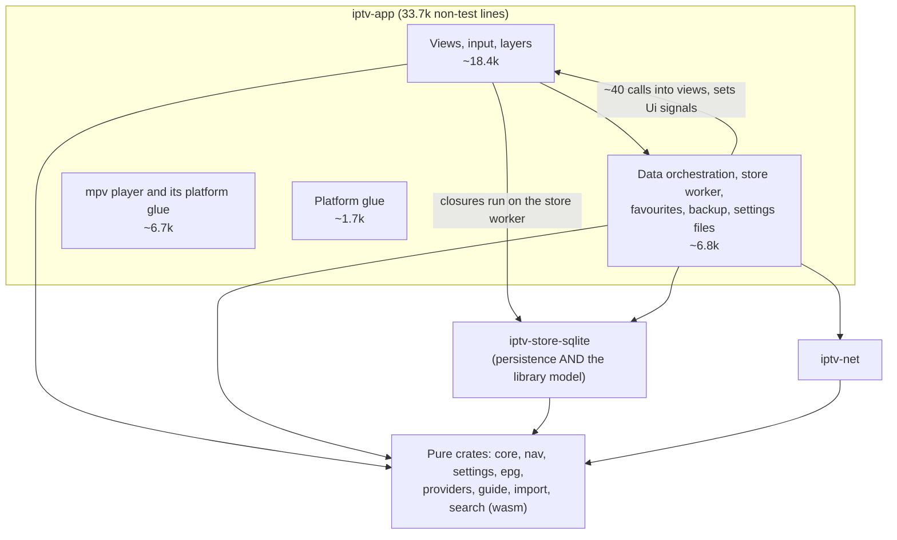
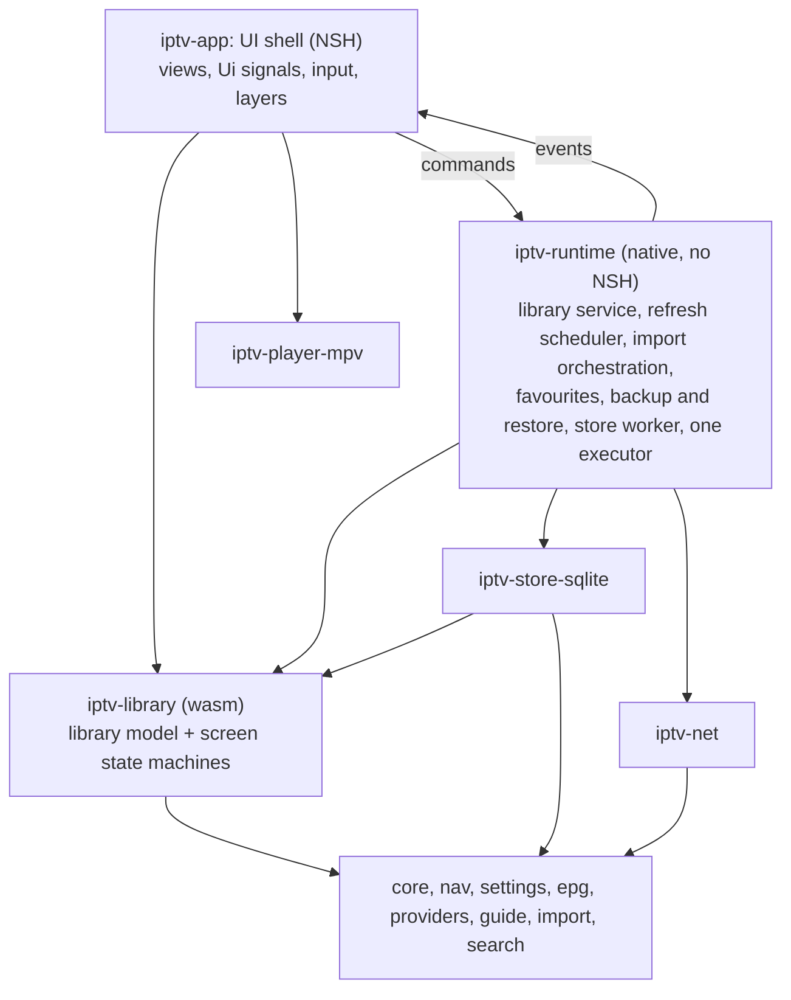

# Refactor plan: an application layer for Patina

This replaces the "structural refactor series" (G1 to G3) sketched in [`2026-11-13-fix-plan.md`](2026-11-13-fix-plan.md). It starts from the architecture as the code shows it at `8c259ee`, not from the audit findings (C16, C17, C18, C41), and then checks the earlier sketch against it.

## The architecture today

What works, and should be kept:

- **The pure crates are real.** Domain logic, parsers and state machines are sans-IO, wasm-built in CI, and tested fast. Import talks to the network only through ports (`Fetch`, `BodyStream`, the sinks).
- **The UI shell follows the project's own rule.** Core state machines (focus, panels, menus, the wizard, multiview, the play bar) live in `iptv-core`; `Ui` holds them in signals; views render and send actions; focus is restored by identity. `Ui` being a `Copy` bag of 46 signals is the normal shape for this reactive style, not a defect in itself.
- **The player is already a clean module.** `mpv/` is 6.5k lines, holds most of the app's `unsafe`, and refers to the rest of the app in only seven places (`crate::transport::policy`, `crate::desktop::x11::keep_above`, `crate::desktop::pip_window::VIEW`, and `crate::media::parse_tracks` in tests). Only `lib.rs` calls into it, through `mpv::register`.

## The three structural problems

Ranked by how much they cost to live with.

### 1. There is no application layer

Everything between a view and SQLite happens inside `iptv-app`, and the dependencies run both ways:

- **Views call the persistence adapter directly.** 35 app files import `iptv_store_sqlite` (30 distinct items), 19 of them outside the data modules. Views such as `organization_view.rs`, `menu_view.rs`, `custom_groups.rs` and `player.rs` send closures to the store worker that call `Store` methods (`store.move_in_custom_group(..)`, `store.load_channels(..)`). The SQLite crate's method list is the app's de facto domain API.
- **Data orchestration calls back into views.** `data.rs` and `data/*` call `crate::player`, `settings_view`, `playlists_view`, `wizard_view`, `multiview`, `lists` and `set_schedule` about 40 times, and set `Ui` signals directly.
- **Runtime state is hidden in statics.** The app has roughly 80 `thread_local!` and `static` items. About half hold runtime state: the current schedule, favourites, combined-mode parts, refresh attempts and tickets, guide status, search indexes, backup progress, the store worker handle. The rest are platform handles (windows, mpv, X11, keystore), caches (fonts, images) and UI-local flags, and are fine where they are.

The consequence: nothing between the views and the database can be tested without NSH, every scenario needs its own process, and a change to refresh or import logic is a change to the UI crate.

### 2. The library model is owned by the SQLite adapter

`SourceId`, `SourcePolicy`, `GuideSource`, `FeedResult`, `ImportErrorKind`, `GuideChannel`, `CustomGroupId` and `OrderScope` are defined in `iptv-store-sqlite`. These are plain data types that describe a user's playlists and guides, and nothing about them is specific to SQLite (none implements a `rusqlite` trait). Because they live in the adapter, anything that wants to talk about a playlist must depend on the database crate.

This is the actual reason the three pure screen-state modules (`playlists_view/state.rs`, `epg_sources_view/state.rs`, `guide_assign_view/state.rs`, about 1,700 lines with their tests) cannot leave the app. They need not just `SourceId` but `Playlist` (which holds `SourcePolicy`, `ImportErrorKind` and `GuideSource`), `SourceLine` (`GuideSource`, `FeedResult`), `GuideChannel`, and app types `Edit`, `Choice`, `Current`, `Form` and `Param`.

There are also two unrelated types called `SourceId`: `iptv_epg::SourceId(u32)` identifies a guide feed, `iptv_store_sqlite::SourceId(i64)` a playlist. The app already renames the first one `Feed` on import.

### 3. The player sits in the wrong crate

Not a design problem, only a packaging one: the module is isolated but compiled, linked and tested as part of the UI crate, and it keeps the app crate from being mostly safe code.

## Does the earlier G1 to G3 sketch make sense?

The direction is right: it aims at problems 2, 1 and 3. As written it would not work, for these reasons.

| Step | As sketched | What the code says |
|---|---|---|
| G1 | Add playlist and feed ID types and move the three screen states into `iptv-core`. | **Not possible.** `iptv-providers` and `iptv-epg` depend on `iptv-core`, and the screens use `iptv_providers::model::Source`, `SecretUrl` and the epg feed ID, so the move would create a dependency cycle. ID types alone are also not enough; see problem 2. |
| G2 | One owned context for schedule, favourites, refresh state and store handle; group `Ui`'s 46 fields; retire the thread-locals. | **Wrong target and too big.** Regrouping `Ui` touches 67 modules and about 1,100 field accesses for no behaviour gain. Half of the statics should stay. The real problem is the two-way dependency between views and data (problem 1); moving the globals into one struct without fixing that only relocates them. |
| G3 | Extract mpv into a crate, and import orchestration plus the store worker into a runtime crate. | **Two unrelated jobs in one step, in the wrong order.** The mpv move is easy and independent and can go first. The runtime half cannot be a move: the data modules call into views, so they have to be decoupled first, which is G2's real job. |
| (C41) | A plug-in point for provider types. | **Drop it.** Three fixed protocols and no plan for a fourth. The audit itself rated the closed enum acceptable. |

## Target

- **The shell** renders and routes input. It talks to the runtime through commands (async calls with results) and applies runtime events to its signals in one place.
- **The runtime** owns everything between the shell and the adapters, including the state now held in statics. It never imports NSH, so its tests run without a UI.
- **`iptv-library`** holds the library model and the pure screen state machines. The store maps rows to its types.
- **Adapters** stay adapters: SQLite, network, player.

Three ratchet tests keep it that way, in the style of the existing `type_drift.rs` (a list of exceptions that may only shrink):

1. no file outside the runtime imports `iptv_store_sqlite`;
2. no file in the runtime imports NSH;
3. no new `thread_local!` or `static` with runtime state outside the runtime.

`iptv-library` joins the wasm build list in `tools/check.sh`.

## Plan

Two pull requests, with an optional third. The pure moves go first because they are cheap and make the hard step smaller.

### R1: Extract the player and the library model

Behaviour does not change; the PR is almost entirely moved code, reviewable with `git diff --color-moved`. One commit per step:

1. **`iptv-player-mpv`.** Move `mpv/` into a new crate with one `register(components)` per platform.
   - The four references back into the app become inputs: the playback policy is passed in when the player is registered, the X11 helper moves with the player, the PiP view name becomes a constant the desktop module imports from the player, and `media::parse_tracks` moves to the crate or to core, since it is a pure parser.
   - Make the props that `video.rs` sends to `tv.player` a typed struct in the new crate, serialized to the same JSON as today. Add one shared JSON fixture and a Kotlin unit test that parses it with the host's existing code, so the Rust and Android sides cannot drift silently. No Kotlin runtime change.
2. **`iptv-library`.**
   - Move `SourceId`, `SourcePolicy`, `GuideSource`, `FeedResult`, `ImportErrorKind`, `GuideChannel`, `CustomGroupId` and `OrderScope` out of the store.
   - The store re-exports them under their current paths, so its callers keep compiling.
   - Rename `iptv_epg::SourceId` to `FeedId` (27 files) to end the name clash.
   - `ImportErrorKind`'s conversions from `ProviderError` and `FailureKind` stay next to whichever crate owns the source type, to keep `iptv-library` free of the import pipeline.
3. **Screen states.** Move `Playlist`, `SourceLine`, `Edit`, `Choice`, `Current`, `Form` and `Param`, then the three state modules and their tests, into `iptv-library`. The app keeps the views. These tests then run without linking NSH.

| | |
|---|---|
| **Depends on** | PR A and PR C merged: PR A edits `iptv-providers`; PR C edits `mpv/handle.rs`, `mpv/map.rs` and `mpv/win.rs`. Can run in parallel with PR D if PR D does not change the store's public types. |
| **Size** | About 9k lines moved, a few hundred changed. |
| **Checks** | `tools/check.sh`; the Windows and macOS CI jobs, because the Windows, macOS and iOS player code does not compile on Linux; the Android compile check from PR B. No device run is needed, since nothing that runs on Android changes. |
| **Result** | The app crate shrinks to about 25k non-test lines; almost all of its `unsafe` leaves; the library model no longer requires SQLite. |

### R2: Put an application runtime between the views and the store

This is the step that changes control flow. It starts as a `runtime/` module inside `iptv-app`, so the UI and the runtime can change in one PR.

1. **Events instead of calls into views.** Define a `RuntimeEvent` enum: schedule ready, library changed, guide status changed, refresh progress, favourites changed, backup progress. The data modules emit events instead of calling `player`, `settings_view`, `playlists_view`, `wizard_view`, `multiview` and `lists`. The shell applies every event in one `apply(ui, event)`.
2. **Commands instead of store closures in views.** For each of the 19 view files that reach into the store, add a runtime command (for example `reset_custom_group_order(group)`) and call it. The store worker becomes private to the runtime.
3. **Runtime state out of statics.** Move the runtime statics (schedule, favourites, combined parts, refresh state, guide status, search indexes, backup state, store handle) into one `Runtime` value. The shell holds one handle to it in place of roughly 40 globals.
4. **Ratchets.** Add the three ratchet tests, with whatever exceptions remain listed explicitly.

| | |
|---|---|
| **Depends on** | PR D. It introduces the shared executor, awaited channels and the read-only connection the runtime builds on. Doing R2 first would mean doing PR D's threading work twice. |
| **Size** | Large: probably 3k to 5k changed lines. If review shows it is too big, split after step 1 (events) and before step 2 (commands); each half stands on its own. |
| **Checks** | `tools/check.sh`; the full scenario suite three times; the `store_latency` scenario; a run on `tab36` and `tv36` covering a refresh while playing, background and resume, and a restore, because event timing changes on Android too. |
| **Open decision** | Where schedules are built. Today they are built on the UI thread because `EpgSchedule` is not `Send` (C40). If the runtime is to build them, `iptv-guide` must switch from `Rc` to `Arc`. Decide with PR D's measurement on a 100k-channel playlist; if building on the UI thread is fast enough, keep it there and have the runtime send the data. |

### R3 (optional): Move the runtime into its own crate

Once the second ratchet holds (no NSH in `runtime/`), moving it into `iptv-runtime` is mechanical. Its value is that runtime tests run without linking NSH, at a fraction of the app test binary's link time. If R2 lands cleanly, this can be the last commit of R2 instead of a separate PR.

## Deliberately not done

- **Regrouping `Ui`'s fields.** It is churn without a behaviour gain. The one grouping with a real benefit, the overlays, comes with PR C's single "top overlay" query.
- **Removing platform handles, caches and UI-local statics.** They are the right tool for a single-threaded UI and FFI.
- **A provider plug-in point (C41).**
- **Removing every `dyn Schedule` downcast.** PR C reviews each site; the rest wait for a concrete need.
- **Sharing one process across scenarios.** NSH and mpv keep their own globals, so process isolation stays even after R2.

## Overall order

| Order | Work | Kind |
|---|---|---|
| 1 | PR A, PR B | Fixes, P1 |
| 2 | PR C | Fixes, P2 |
| 3 | PR D and R1 (in parallel if PR D leaves the store's public types alone) | Fixes / pure move |
| 4 | PR E, PR F | Fixes, P2 |
| 5 | R2 (with R3 folded in if it goes smoothly) | Refactor |

## How to tell it worked

| Measure | Now | After R1 | After R2 |
|---|---:|---:|---:|
| `iptv-app` non-test lines | 33.7k | about 25k | about 18k (views and shell) |
| App files importing `iptv_store_sqlite` | 35 | 35 | 0 outside the runtime |
| App files the data modules call into | about 10 | about 10 | 0 (events only) |
| Statics holding runtime state | about 40 | about 40 | 0 outside the runtime |
| `unsafe` blocks in `iptv-app` | most of the workspace's | platform glue only | platform glue only |
| Screen-state and runtime tests that link NSH | all | runtime only | none (with R3) |
