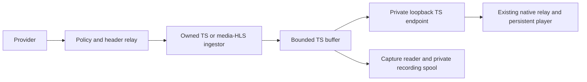

# Shared live inputs

Patina can watch and record a direct MPEG-TS stream or an unencrypted
MPEG-TS HLS **media playlist** through one incoming owner. Provider requests
come from one ingestor; HLS manifest reloads and segments are fetched sequentially,
without a second playback/capture downloader.

Adaptive/master HLS playlists retain native variant selection. Encrypted HLS,
fMP4, DASH and external audio/subtitle renditions retain native playback through
an owned HTTP passthrough relay. The relay preserves all variant choices and
request policy; it does not make these transports shareable with capture.
Recording uses its existing independent transport when a separate connection
is permitted. A preparation probe closes and acknowledges upstream retirement
before native fallback opens. HTTP VOD and catch-up playback use the same owned
passthrough lifetime, so a later live probe cannot overlap their retired owner.

Non-HTTP native transports retain their original player path. While handing off
from such an unowned provider transport, Patina avoids speculative shared-input
probing and publishes the independent path after ordinary admission. A saved
local recording is not a provider transport and does not suppress a live probe.

## Ownership and admission

Portable `iptv-core::live` values define source incarnation/channel identity and
count unique incoming connection IDs. Runtime admission additionally checks the
source configuration, final resolved URL and headers, and complete transport
trust policy. Numeric source IDs, matching channel text, or matching addresses
alone grant no sharing authority. Imported schedules retain an opaque,
nonserializable source incarnation/configuration snapshot. Resolution binds the
original channel before portal I/O. Preparation compares that origin after the
surface gate and again before publication; edits reject stale results instead
of rebinding credentials or account budgets. Selection searches all ready
owners using the complete resolved URL, headers and trust policy.
Viewing and capture use the same
local-offset clock helper. Naturally rotating live URL templates, refreshed
links, changed authentication/format context or changed trust policy may no
longer match an existing input; those cases require the permitted independent
fallback rather than weakening URL/header equality.

The runtime registers an incoming ID with its original account lease before
starting provider I/O. Pending preparation, playback and capture references use
that same ID. Registered owners remain budgeted through cancellation and
acknowledged upstream closure, even if a surface switches to another account,
a recording finishes, a claim fails, or its UI disappears. A closing owner cannot
acquire new consumers. Replacement may plan to retire its sole old viewer owner;
actual replacement I/O waits for that retirement. Rejected selections do not
cancel or revise an already admitted preparation.

A recording retains its own reader and incoming lease. Stopping playback or
zapping releases only viewing ownership. Returning to a still-recorded channel
can reuse that incoming owner. Other channels and unsupported transports require
their own permitted connections. Unknown account association keeps the existing
conservative budget behavior.

Android/background-capable hosts run preparation and ingestion on the recording
host executor. UI-engine teardown cannot destroy that executor or its capture.
Suspended native players retain an incoming owner only while a capture needs it;
retained suspended owners remain counted. A native resume whose old local
capability retired uses the normal playback retry path.

## Bounded media behavior

The ingestor aligns output to complete 188-byte TS packets. Its shared rewind
buffer is bounded to 4 MiB; one HLS segment uses the existing recorder's 32 MiB
validation limit. The most advanced consumer governs read-ahead: ingestion pauses
once its unread window reaches 2 MiB. Advancing capture continues while playback
is paused, and advancing playback continues when a capture stalls. If every
consumer stalls, ingestion pauses. A consumer behind the retained window receives
an explicit gap; bytes are never silently skipped. Live provider pacing is preserved. Synthetic
finite inputs used for native validation are throttled at their upstream server.

A late capture starts at the current cursor, with at most 512 KiB of exact TS
pre-roll from the most recently received PAT start. That interval is used only
when its PAT arrived within two seconds of attachment; it can contain a short
pre-attachment programme interval. It preserves packet ordering and section
continuations. A multi-section PAT/PMT may finish only as live input continues;
Patina does not synthesize tables or claim readiness from a PAT alone. If no
bounded recent interval exists, the reader continues at the live edge and receives
subsequent programme tables naturally.

Starting or stopping capture never changes the player's source, load token,
view placement or native surface. Capture uses the existing secure spool writer
and recording finalization path. Synchronous writes cannot race finalization
when capture is cancelled. A shared stream ending or skipping before its stop
or deadline finalizes retained complete packets as Partial (or Failed with no
media). It does not silently switch to an independent capture that would consume
the viewer's only connection; playback can retry a fresh shared input.

## Synthetic verification

The transport tests cover authenticated generated TS/HLS request and active
connection counters, capture ownership after playback drop, capture stop,
bounded lag, paused-playback capture progress, reader lifetime, preparation
cancellation, unsupported-probe retirement, and bounded current PAT intervals.

Runtime tests cover immediate replacement peak connection count, distinct-account
pending cancellation, source reincarnation, auth-context mismatch, capture stop,
shared failure followed by fresh playback, suspended sharing, UI executor teardown,
and native master-playlist fallback with independent capture admission. Native
validation must additionally exercise the unchanged Apple, Android and desktop
player adapters and their persistent surfaces. Only generated local media and
isolated application data are used.
