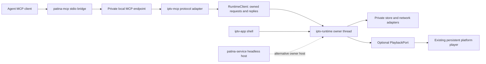

# Patina MCP implementation plan

Date: 2026-11-14. Status: implementation plan; review verdicts are in the companion review log. Scope: design and delivery plan; no MCP implementation is included in this change.

## 1. Product outcome

An agent can help a user find something to watch, operate an available playback session, explain playback or guide failures, organize a library, and find the correct EPG for channels. These operations work through application services without inspecting or driving the UI. An agent alongside the application uses the same runtime owner, library, credentials, and playback session. A headless owner supports the same data operations without loading NSH or a player.

The first useful release covers library/programme discovery and EPG repair end to end. Playback control follows once a real player command/result port exists. MCP is an adapter, not the home of business logic, a new agent framework, or a reason to expose every internal method.

### Representative workflows

| User intent | Sequence | Observable completion |
|---|---|---|
| Find something suitable to watch | Search channels/programmes with explicit time/language/source filters; inspect candidates; request play by stable identity | Matching choices; with a player, acknowledged playback or a specific failure |
| Fix missing or wrong guides | Audit coverage; inspect identity and current binding; discover/probe feeds; compare candidates; preview mappings; apply and verify | Persisted mappings, actual schedule coverage, unresolved channels, and undo handle |
| Explain a blank guide | Separate unavailable feed, failed import, missing identity, ambiguous match, stale programmes, timezone error and disabled guide | Evidence and a targeted repair, not an unconditional refresh |
| Explain a playback failure | Read session state and sanitized diagnostics; inspect source/account constraints; optionally perform a bounded probe | Specific failure stage and next action, without starting an extra stream silently |
| Clean up a library | Search explicit sources; preview favorites/hidden/group changes; apply by stable identity | Durable changes reflected in all clients without moving UI focus |
| Maintain guides over time | Re-run coverage/health checks after refresh and report deteriorating or invalid mappings | Drift report; no silent replacement of explicit choices |

## 2. Baseline and relationship to #37 / R4

This plan was inspected against master `5fa7a534eb3135ad5202e4c7553f5a8f25f85830`, [PR #37](https://github.com/teng-lin/patina-iptv/pull/37) at `4c54bc37623d3f62f8df655b7c6ba75c90461d19`, and the R4 contract in [the audit fix plan](../audit/2026-11-14-fix-plan.md). The R4 worktree is active and has uncommitted changes. It is not a completed API specification.

| Existing or planned work | What MCP may reuse | What it must still add |
|---|---|---|
| #37: standalone native `iptv-runtime`, private store service, injected storage/key/platform ports | UI-free application owner and native tests | Headless host, external service facade, lifecycle and ownership protocol |
| R4 D08: import/combined/paging/guide orchestration moves into runtime | Actual headless orchestration | Source-explicit queries independent of shown schedule |
| R4 D09/D10: encapsulated runtime, library DTOs and runtime errors | Domain methods and public value types | Stable wire DTOs, correlated requests, authorization and revisions |
| R4 D11: typed player props/events | Player adapter vocabulary | Playback session service and command acknowledgements; typed events alone do not provide it |
| Audit I: responsiveness, timers and data-path fixes | Correct refresh ownership/cancellation | Fair external requests and concurrent-client verification |

All production changes touching runtime or shell stack after the actual R4 result, and include audit I fixes required by R4. Documentation, protocol fixtures and pure matching design can proceed independently. Re-read and record final #37/R4 commits before M1; amend this plan if their API differs. Do not duplicate, rename or move runtime code on master in parallel with R4, and do not add MCP scope to the behavior-preserving R4 change.

Important limitations in the inspected #37 code:

- `Runtime` uses `Rc`, `RefCell`, local futures, and a single replaceable `bind()` event sink. It cannot be passed directly into a multithreaded MCP handler, and MCP must never install a second sink that displaces the shell.
- Playback helpers currently build context and save resume state; they do not control an active player.
- Search uses presentation-oriented offsets and the currently built schedule. That is insufficient for an agent searching another playlist.
- EPG inventory includes channels whose programmes were not retained: imports filter programme data to matched channels. Candidate inspection cannot assume the full feed is in SQLite.
- `assign::save` can persist a preference even when cached rebinding is unavailable; some read helpers convert errors to empty/default values. MCP needs explicit errors and separate saved/effective outcomes.
- There is already a process-global storage lock in `backup/instance.rs`, a single FIFO reader lane, and a fixed default credential item. Extend these deliberately; multiple production profiles, persistent database revision counters and PIN-based parental control do not already exist.

## 3. Components and dependency direction



Proposed packaging:

- `iptv-library`: portable domain DTOs and identities shared by shell/runtime, where they belong naturally. Remains wasm-safe and sans IO.
- `iptv-epg`: portable candidate generation, evidence classification and coverage calculations. No networking, clock access or model calls.
- `iptv-runtime`: application commands, queries, revisions, job/plan lifecycle and ownership of mutations. Add an explicit client facade and a sendable handle backed by bounded channels. No MCP or NSH dependency.
- `iptv-mcp`: native library for schemas, permission enforcement and translation to runtime requests; server implementation using `rmcp`, the crate in the official `modelcontextprotocol/rust-sdk` repository. It imports public runtime/library interfaces, never SQLite or shell modules. Contains the `patina-mcp` executable for stdio relay.
- `patina-service`: small native host executable, potentially in the same package initially. Provides a local executor, storage/key ports, lock and endpoint lifecycle, and no player by default. Keep host bootstrap separate from protocol translation.
- `iptv-host-native`: small native host-support crate shared by app and headless service for credential brokers and OS storage ports. `keyring` stays here, not in `iptv-runtime`; preserve its architecture guard. It has no NSH dependency.
- `iptv-app`: optionally hosts the same endpoint and supplies its existing runtime handle and player port. Put the SDK/endpoint dependency behind a desktop-only Cargo feature, disabled for Android/iOS. No MCP query depends on an open view, focus index, visible playlist or UI signal.

The `Send + Sync` facade contains channels and owned DTOs only. A dispatcher runs on the runtime's existing owner thread, enters the correct owner context, and executes local futures. It never holds a `RefCell` borrow over an await. The headless host supplies a local executor; the app supplies its owner-loop scheduling port. Network work, parsing and database work use existing workers. No per-request executor, blocking UI wait, global owner switching, or `unsafe Send` implementation.

Large candidate generation/scoring, coverage scans and serialization preparation run on bounded workers over owned immutable snapshots. Publish results on the owner thread only after checking their captured revisions. The owner loop does admission and state transitions, not an unbounded scan of a 100,000-channel catalogue.

Add one runtime-owned external-query lane on a dedicated blocking worker with its own `query_only` connection created through `Store::open_reader`; do not queue long MCP reads on the existing UI reader FIFO or execute synchronous SQL in transport tasks. Its SQL progress handler/interrupt hook enforces cancellation and deadlines, and its connection is retired/reopened with the owner's storage epoch during restore. Open it eagerly before endpoint readiness; on reopen, a deadline includes waiting for the writer to create the reader. Bound snapshot duration to avoid unbounded WAL retention. UI reads keep their own lane. Prepare plans and coverage off the writer lane; only bounded validation/commit work occupies it. Each atomic batch is bounded (initial maximum 500 mappings); reduce that limit if measurements require it, rather than yielding halfway through an atomic transaction. Between independent batches, UI writes may run.

A command has a correlation ID, client identity, deadline, cancellation token and explicit scope. A reply is a result or an accepted operation ID. Shutdown stops admission, drains or marks accepted work interrupted, completes outstanding replies, retires subscriptions and releases ownership last.

Keep shell events intact. Publish separate sanitized domain invalidations after committed state changes; a fan-out hub gives MCP clients bounded queues. Slow clients cannot block the UI or lose correctness: coalesce invalidations, report a sequence gap, and require snapshot reload. Never serialize `RuntimeEvent` directly; it contains presentation requests and non-wire values.

## 4. Hosting, connection and ownership

Initial desktop transport: standard MCP stdio externally, private local socket internally (Unix-domain socket on Linux/macOS; named pipe with current-user ACL on Windows). Each bridge connection relays a separate MCP session to the owner's adapter using bounded newline-framed JSON-RPC. There is no second domain RPC API and the bridge never opens the database. Logs go to stderr; stdout contains protocol messages only.

Unix discovery/socket files live in an owner-verified private runtime directory (mode `0700`), checked before binding, connecting or unlinking. Windows uses an explicit user/logon ACL, rejects remote pipe clients, verifies the endpoint peer and opens the client handle at identification-only impersonation level. These checks apply before exchanging MCP data; test them on the target OS, including hostile discovery paths. See [Windows pipe access](https://learn.microsoft.com/en-us/windows/win32/ipc/named-pipe-security-and-access-rights), [remote-client rejection](https://learn.microsoft.com/en-us/windows/win32/api/namedpipeapi/nf-namedpipeapi-createnamedpipew) and [client impersonation control](https://learn.microsoft.com/en-us/windows/win32/ipc/impersonating-a-named-pipe-client).

Use a short hashed socket basename under that private runtime directory, not the potentially deep data directory; validate the complete path against the target OS socket-path limit before binding. The local-only prelude is one UTF-8 JSON line, at most 256 bytes, containing `version: 1` and the logical `client_id` UUID, followed by standard MCP frames. Reject invalid versions, malformed/oversized preludes and extra fields before initialization. Limit every subsequent frame separately. This internal prelude is never sent to the external stdio client.

Use the official Rust SDK with an exact reviewed release and minimal features, locked in Cargo.lock. Compatibility target: MCP `2025-11-25` over stdio, with initialize negotiation and tested fallback to `2025-06-18` for the tools/resources subset used here. Do not claim every SDK-supported revision. Pin client versions in compatibility tests; newer transport revisions need separate verification. Optional task extensions, sampling and elicitation are not required.

Commands proposed for packaging, not currently implemented:

```text
patina-mcp --connect existing
patina-service
```

`--connect existing` is the default and fails clearly when no owner is available. Starting a headless service is explicit; an agent launch must not unexpectedly create an empty library or take ownership away from the app.

In this document, **profile** means the app's canonical data directory and its existing credential binding. Production v1 supports only that default directory; it introduces no `--profile` selector or new credential namespace. Synthetic tests may inject independent directories and test keys through `Ports`. User-selectable multiple profiles need a later key-namespacing/migration design, preserving the current default Secret Service item.

Ownership rules:

1. Extend the existing sibling `<data-dir>.instance-lock` mechanism in `backup/instance.rs`; do not add a competing lock. Replace its process-global `OnceLock<File>` fast path with a canonical-root-keyed owner guard, acquired before `Runtime` construction, restore activation or storage services. The guard remains outside the directory swapped by restore. Same-root recreation reuses the existing host/guard, while a second distinct owner cannot bypass it. App and headless host use this even with MCP disabled. Every detached storage task retains the guard until it closes its handles; release only after retirement and drain/join. A drain timeout must not unlock while a worker can still write. Test both multi-process exclusion and two synthetic roots within one process. SQLite locks alone are insufficient.
2. Publish readiness metadata only after lock, key access, initialization and endpoint binding succeed. Metadata contains profile ID, owner epoch, endpoint and supported API version; permissions limit it to the user. Verify peer identity and directory ownership, reject symlinks/untrusted discovery files, and treat a PID as information rather than proof of ownership.
3. An app owner accepts many bridges and remains alive when any bridge exits. No bridge launches a second owner on connection failure.
4. A headless owner excludes a second app owner for the same profile in v1. Starting the app returns an actionable owner-busy result. The user may stop the headless service, wait for drain and start the app. Seamless live handoff and an app acting as a remote runtime client are deferred; no hidden takeover or simultaneous writers.
5. Stale endpoint cleanup requires the exclusive lock. A crashed owner is detected by OS lock release, not by deleting a live lock file. Generate a random 128-bit owner epoch at startup and after restore; it must not repeat because the database was restored. New epochs invalidate cursors/plans and stale playback commands.
6. Use the same profile data directory and credential broker as the app through `iptv-host-native`. Add a noninteractive broker mode: headless startup fails promptly when locked and must not invoke the current 30-second Secret Service unlock prompt. Never copy secrets into CLI arguments, fall back to an unrelated plaintext store, or synthesize a new key when an existing profile is locked. Report `credential_locked` / `credential_unavailable` with an external unlock path. Creation of a new empty profile is outside this v1 command; no-existing-profile is an explicit error.

Linux is the first host acceptance target. Windows/macOS host support is released only after packaged-binary credential access and endpoint tests pass. In particular, verify that the signed macOS app and headless binary can access the same existing key without an interactive prompt, using the platform's supported shared-access setup and migration when required. Until that is established, advertise macOS headless as unavailable rather than silently creating a second key; app-hosted MCP can be tested separately. Android/iOS have no endpoint feature in v1.

Headless periodic refresh/guide-check scheduling is off by default; explicit `source_refresh` still works. A user can enable the existing refresh policy outside model-controlled calls, with its source connection/network limits. App-hosted mode retains the app's scheduler and coalesces external refresh requests with its existing work.

Endpoint access is opt-in per profile. OS user identity establishes the local trust boundary. Persist scope policy in that profile and apply it server-side; tool annotations are not authorization. Initial scopes: `library.read`, `diagnostics.read`, `epg.probe`, `epg.write`, `library.write`, `playback.control`. The read/probe scopes and write scopes are distinct; probes access the network. A configured grant persists, so routine authorized operations need no repeated in-app confirmation. All local processes under the same OS identity share that trust boundary; strong isolation between hostile same-user clients is not promised.

Configure grants outside MCP with a documented local `patina-service configure` subcommand that acquires the same instance lock and atomically writes private `mcp-policy.json` in an owner-verified sibling control directory outside the restored data set. Restore must never reinstate broader grants from a backup. It is an offline configuration action: an active owner returns owner-busy. The owner reads policy at startup, never silently reloads an agent-edited file mid-transaction, and exposes granted scopes in status. An eventual app settings surface uses that same schema. No tool grants itself scopes.

Logical client identity is a persisted random UUID in private local bridge configuration, established outside model-controlled tool calls. An authenticated local connection supplies it in a bounded transport prelude before MCP initialization; this is connection metadata, not a domain command API. It is independent of MCP `clientInfo`, request IDs and transient session IDs. Bridge restarts reuse it so plans and idempotency receipts remain accessible. Separate client configurations receive separate UUIDs; two bridges may intentionally share one and then share its request-key namespace. This is an operational identity under the same-user trust boundary, not a promise of isolation from another process running as that user. Configuration reset creates a new client identity and never silently adopts another client's pending work.

Remote/LAN access and Streamable HTTP are a later transport milestone, requiring explicit authentication, origin/host validation, TLS/deployment decisions, per-client grants and protocol-version tests. They are not needed for an agent on the same desktop. Android TV remote control is therefore not part of the first desktop release; runtime semantics stay portable across native hosts.

## 5. Common contract

### Identity, scope and freshness

Use profile-scoped opaque external IDs mapped internally to `(playlist SourceId, channel ContentId)` and `(playlist SourceId, FeedId, XMLTV channel ID)`. Do not expose raw IDs if they encode provider URLs, credentials or stream paths. Never use screen offsets, display names or array indices as identity. Preserve mapping across ordinary refreshes; deletions/restores change the relevant generation. Combined-library results retain their original source identity.

Continuity is conditional on the provider identity remaining the same. Existing M3U identity may change with a name/path change or duplicate ordering. Treat such a change as disappearance/new content and require a new reviewed match; never guess continuity and carry an override to a different stream.

Every query takes explicit source IDs or `scope=all_enabled`, plus an explicit time window where relevant. Defaults do not read UI selection. Return UTC timestamps plus known source timezone/display context, data age and a snapshot revision. Paginate deterministically, default 50/max 200 rows; revision-bound opaque cursors fail with `stale_cursor` after relevant changes rather than skip/duplicate rows silently. Bound text fields, windows and response bytes (initial ceiling 256 KiB). Stable IDs remain available in truncated results.

Cursor keysets and cached identities use semantic keys (source identity, stable content ID and declared semantic sort fields), never SQLite rowid or FTS docid. A no-op refresh may physically replace those rows without advancing a semantic generation; it must still permit correct continuation between pages. Overlay/source enable-policy changes invalidate the scopes they affect.

Revision domains: owner epoch; library/catalogue generation; organization/visibility generation; per-feed content and configuration generation; mapping/override generation; playback session generation. Use persisted counters for durable changes and a fresh owner epoch for in-memory state. All writers, including UI edits/imports/restores, must advance affected revisions in the transaction that semantically changes them. Hidden/blocked/group/name edits advance their appropriate visibility/organization domain and invalidate dependent search snapshots, without invalidating unrelated EPG mapping rows. Do not build concurrency checks solely from MCP request history.

**M1 storage work is new, not supplied by R4.** Add a schema migration for database domain revisions and an opaque external-ID registry. Key that registry by `(source_id, ContentId)` with independent random opaque IDs, never a catalogue rowid or a foreign key cascading from replace-all channel rows. Retain identities through ordinary replace-all imports; collect them on source deletion or explicit identity-retention cleanup, not a temporary channel omission. Bulk-upsert indexed identities during import and benchmark the 100,000-row cost.

Record last-seen publish time; retention cleanup may collect an identity absent for 90 days only when no overlay, live plan, inverse record or retained receipt references it. Document that reappearance after collection obtains a new opaque ID. Configured EPG candidates use a separate registry keyed by source, opaque feed incarnation and XMLTV ID. A feed incarnation includes the private configuration identity fingerprint (location/credential reference and provider index), because numeric `FeedId` values can be reused after deletion. Keep that fingerprint private and record it in plan/receipt/inverse preconditions, not just numeric feed presence.

Use column-specific, value-change-guarded triggers only on small user-edited tables: e.g. actual changes to the override triple `(epg_mode, epg_source, epg_channel)` advance mapping revision, while unrelated rename/hide columns do not. Insert/delete handling must distinguish an effective override from an otherwise empty overlay. Do not add per-row revision triggers to bulk channel/programme tables. Centralize one change-based bump in each store publisher/maintenance transaction (`publish_stage`, `replace_staged`, `rebind_epg`, prune, source delete), with a test inventory of all affected legacy and new mutation paths. Compare the canonical feed-configuration list and catalogue semantic digest before bumping; a delete/reinsert of identical content is not a change. Programme-content changes advance their data generation once per publish. Internal journal/receipt writes do not advance domain revisions. Build cursor snapshots from one read transaction and their relevant revision tuple.

Compute a canonical SHA-256 catalogue digest during staging off the writer lane, covering catalogue-derived fields used in query filtering, ordering and returned metadata. Exclude secret/rotating stream locators and volatile import timestamps; report their health/freshness separately. Do not reuse the additive matching fingerprint as sole evidence of unchanged catalogue content. Persist the digest per source; a legacy source without one advances once. The mutation inventory explicitly includes standalone `set_guide_sources` through its shared `set_guide_sources_in` comparison, orphan-overlay purging and source enable/policy edits. Update backup schema/trigger allowlists and synthetic fixtures with each migration.

Generations serve cache/report/cursor invalidation and an apply-validation fast path; they are not a blanket ban on a plan after any source edit. Apply/undo correctness uses row-level preconditions captured in the immutable plan: affected channel identity and relevant matching metadata, current override triple, referenced feed settings/presence and protected flags. Under the writer transaction, a generation mismatch prompts comparison of those relevant rows. If they still match, the operation can proceed; if they differ, return precise conflicting rows and require a new preview. Current authorization and protected-content policy are always checked. Owner replacement, restore, expired evidence or an unavailable stage remain hard plan-invalidation boundaries.

M1 also establishes durable operation/receipt tables. M3b adds repair-plan, inverse-record and audit-journal tables in a subsequent migration; plan persistence is a prerequisite for shipping apply. Atomicity claims concern database-owned feed configuration, overrides and their receipts. File-backed settings/resume state are excluded from mutation plans; use owner-epoch-scoped revisions for their status. Favorites are SQLite-backed but have a separate pending-write queue: M5 must serialize UI and agent changes through the shared commit path, drain earlier queued writes before taking the expected row values/revision, and install the committed result back into the UI cache. It cannot apply SQL behind an outstanding optimistic UI write.

Backup includes durable domain state and provenance, but restore never treats backed-up live plans/jobs/receipts as current operations. Restore has an exclusive admission gate, drains/retires all query lanes and workers, advances the owner epoch, clears staged/planned work and marks unfinished operations interrupted. Old receipt history is read-only provenance and is tagged with its origin incarnation; it cannot cause reapplication. A fresh request namespace is required after restore, while ordinary owner restart retains receipts for lost-response recovery.

### Results, jobs and errors

Return typed `structuredContent` with a matching output schema and a concise text rendering for clients that only display text. Expected domain failures are tool errors with stable codes and remediation fields, not leaked exceptions or fake empty results. Invalid protocol requests use JSON-RPC errors. Examples: `not_found`, `ambiguous_identity`, `stale_revision`, `policy_denied`, `credential_locked`, `busy`, `rate_limited`, `source_unavailable`, `coverage_insufficient`, `player_unavailable`, `unsupported`, `cancelled`, `interrupted`.

Long refresh/probe/verification work returns an operation ID; `operation_get` / `operation_cancel` provide a universally usable fallback. Jobs have queued/running/cancelling/succeeded/failed/cancelled/interrupted states, explicit partial outcomes and bounded progress. Persist accepted mutation IDs and terminal receipts so a lost response can be reconciled. Restart marks unfinished jobs interrupted unless an explicitly safe resume exists. Client disconnect does not cancel an already accepted durable mutation; request cancellation and job cancellation have different lifetimes. Cancelling after commit cannot claim rollback.

All mutations require an idempotency key scoped to profile/client plus a canonical payload hash. Same key/same payload returns the original operation/result; same key/different payload fails. Retain receipts for seven days initially, expose the retention boundary, and never automatically replay an expired or uncertain mutation.

`operation_get` accepts either an operation ID or the original idempotency key for the authenticated logical client. Thus a restarted bridge with a new MCP session can recover a commit whose first response (including its operation ID) was lost. Receipt lookup precedes owner-epoch validation of a retry: an already committed operation can be reported after owner restart even though its old preview can no longer be applied.

Default admission limits: 32 queued requests per client, 8 active queries per client, one import/probe per source and two probes per owner. Rate-limit expensive operations and reserve capacity for UI/runtime work. Set/query deadlines are bounded; large changes are paged plans rather than unbounded tool payloads. Tune these ceilings with synthetic scale measurements.

## 6. Tool surface by delivery stage

Names below are proposed stable tool names. Each gets a narrow JSON schema, scope requirement, result DTO and examples; no arbitrary SQL, shell, filesystem or generic runtime-command tool.

| Stage | Tool | Inputs and outcome |
|---|---|---|
| M2 | `runtime_status` | Capabilities, profile/owner epoch, versions, readiness, allowed scopes, available player |
| M2 | `library_sources` | Paged sanitized source identities, health, enabled state; no credential-bearing URLs |
| M2 | `channel_search` | Query, explicit source/group/language filters, hidden policy, cursor; stable identities and match evidence |
| M2 | `channel_get` | Channel ID; metadata, guide choice/effective binding, catch-up metadata, freshness |
| M2 | `programme_search` | Query, source/channel filters and UTC interval; bounded programmes with provenance |
| M2 | `channel_schedule` | Channel ID and UTC interval; schedule, gaps and data age |
| M2 | `epg_audit` | Source/channel scope and interval; missing, ambiguous, stale, disabled and covered counts/details |
| M2 | `epg_sources` | Configured feeds, precedence, offsets, last fetch/result and coverage; paged |
| M3 | `epg_candidates` | Channel IDs, configured/staged feed IDs; ranked candidates, evidence and conflicts |
| M3 | `epg_source_probe` | Public candidate feed URL or configured credential reference, scope and limits; bounded staged feed snapshot and operation ID |
| M3 | `epg_candidate_schedule` | Probe/feed identity, candidate channel and window; sample programmes or explicit missing/stale state |
| M3 | `epg_plan_create` | Selected candidates, proposed feed additions/settings, affected channels and expected revisions; immutable preview plan |
| M3 | `epg_plan_get` | Plan ID/cursor; paged before/after mappings, unresolved items, effects and expiry |
| M3 | `epg_plan_apply` | Plan ID, digest and idempotency key; validate stored row preconditions/revision hints, return atomic commit and verification operation |
| M3 | `epg_plan_undo` | Commit/undo ID, inverse digest and idempotency key; CAS against committed after-values, return inverse commit plus optional verification operation |
| M3 | `epg_verify` | Mapping/source scope, interval and revision; observed coverage and identity uncertainty |
| M3 | `source_refresh` | Source IDs, catalogue/guide scope and idempotency key; coalesced bounded job |
| M2/M3 | `operation_get`, `operation_cancel` | Get by operation ID or logical-client idempotency key; cancel by operation ID; cancellation never implies rollback |
| M4 | `playback_status` | Session ID or list; content, state, capabilities and sanitized failure stage |
| M4 | `playback_play` | Stable channel/programme/content ID, target session, expected generation, live/catch-up mode and idempotency key |
| M4 | `playback_control` | Closed action enum: pause/resume/stop/seek/select-track; typed action fields, expected generation and idempotency key |
| M4 | `playback_diagnose` | Session/content ID; passive observations by default, explicit bounded active probe when allowed |
| M5 | `library_plan_create`, `library_plan_get`, `library_plan_apply`, `library_plan_undo` | Favorites, visibility and custom-group changes using the same revision/preview/commit semantics |

`runtime_status` distinguishes implemented capabilities, policy grants and transient availability. A tool unavailable due to no attached player returns `player_unavailable`; it never launches another player implicitly. Source creation/deletion, credential editing, backup restore, DVR recording, full settings control and playlist export are deferred until separately specified. Metadata reports catch-up support as advertised versus verified; it does not promise playable archives from an EPG entry alone.

**M2 blocked/hidden policy is explicit new service work.** The baseline has a `blocked` overlay, but not an implemented PIN/unlock service. Omit blocked content and its programme metadata from MCP searches, schedules, candidates, resources and notifications. Direct access by a known ID returns `policy_denied`, including playback. Hidden content is omitted by default; explicit `include_hidden` is permitted only under the configured library grant, and never overrides blocked state. No MCP tool changes `blocked`, parental settings or PINs, and any future UI unlock window does not automatically authorize MCP. Filter report totals to the caller's visible scope. M4 routes UI and MCP playback through the same runtime block check; this is a required change, not an assumption that the current UI already enforces full parental control.

Offer small read-only resources such as `patina://runtime/status`, `patina://epg/audit/{report_id}` and `patina://operations/{operation_id}`. All large reads remain paginated tools. Optional resource subscriptions publish invalidations; polling works when a client does not subscribe. Three optional prompt templates describe discovery, guide repair and playback diagnosis, but every workflow works through tools without prompts, sampling or any particular LLM.

## 7. EPG discovery, matching and repair

### 7.1 Audit the problem before changing it

Classify configured feed failure separately from missing channel metadata, unmatched channel, ambiguous identity, intentional no-guide choice, mapping to an empty feed, stale schedule, partial coverage and suspicious timing. Report both channel-count coverage and programme-time coverage over an explicit horizon (default next 48 hours). A legitimate overnight/off-air gap is a gap, not proof of an incorrect mapping. A programme list that reaches a future date is not necessarily current or correct.

### 7.2 Discover feeds without making the server a web crawler

Search configured feeds first. The external agent can use its web search capabilities to find additional documented feeds or source catalogues and submit candidate URLs to `epg_source_probe`. The server itself needs no search API key, browser, model or bundled catalogue of real provider channels. With no web-search tool, it still repairs against configured feeds or candidate URLs supplied by the user. A future curated source catalogue is a separately maintained data product, not a prerequisite.

Persist source provenance, retrieval time, content fingerprint and provenance URL when appropriate, with secret-bearing locations stored privately and only opaque references exposed. Stage discoveries until a plan explicitly adds/enables a feed; probing must not change feed order or live mappings. Support multiple feeds per playlist and channel-specific choices; one feed need not cover everything.

A public candidate URL must be HTTP(S) without embedded credentials. Private feeds use a previously configured secret reference rather than asking the model to handle credentials. A source needs a usable documented access method; an HTML schedule page is not an XMLTV feed. Discovery must return unsupported/authentication-required honestly instead of inventing endpoints or promising access.

### 7.3 Probe and stage efficiently

Route every fetch through `iptv-net` policy, including every redirect. For agent-supplied public URLs, reject loopback, link-local, metadata and private destinations; check resolved addresses at connection time and on redirects. An explicitly configured local feed can use the existing narrow per-source network policy. Never forward another source's authorization or unfiltered Origin/Referer across origins.

M3a depends specifically on audit G/D02's cross-origin header privacy fix or an equivalent verified fix, in addition to R4; unrelated mpv relay fixes do not gate EPG probing. Reuse `iptv-net::PublicResolver` and add the probe policy/per-hop tests against the final transport implementation. Reusing `iptv-net` by itself is not evidence that every required redirect/header policy is already satisfied.

Set separate compressed/decompressed byte, XML nesting/text, time, redirect and channel/programme budgets; initial probe ceilings: 32 MiB compressed, 256 MiB expanded, 3 redirects and 60 seconds. XML entity expansion/external entities are disabled. Streams are parsed incrementally with cancellation. Size-limit failures are explicit; they do not create a misleading successful partial match.

Keep a bounded temporary index of discovered channels and only the requested candidate programme windows. Retain the bounded compressed/raw payload in private encrypted staging so later candidate schedule requests parse the exact same snapshot; decompression is budgeted on each pass. Use a random secret key per owner epoch for this disposable cache (never derived from the public epoch ID), erase it at shutdown, and remove unreadable old stages at next startup; no additional credential prompt is permitted. Use on-disk staging, with a 24-hour TTL and an initial 512 MiB total profile budget including payload/index overhead. Reject or evict unreferenced stages before exceeding the budget; a dependent plan becomes stale on eviction. Do not load an entire large feed into model context or bypass the normal filtered import. A stage records its source/content/config revision and never becomes authoritative merely because a probe succeeded.

### 7.4 Evidence and ambiguity

Extend the portable matcher to return all relevant candidates and reasons; preserve the existing automatic path until a separately tested behavior change is accepted. The current normalized-name ambiguity fallback picks the first document entry. Agent-assisted suggestions must surface that ambiguity and must not treat document order as evidence.

Candidate evidence includes exact/alias ID, full and normalized name, original country/region tag, language, broadcaster/station identity when known, timeshift edition, schedule samples, source provenance and freshness. Keep country/region and `+1`/`+2` variants as identity information even when display normalization removes other decorations. HD/SD equivalence is a possible match, not a universal rule. Source-scoped XMLTV IDs are not globally unique.

Return deterministic classifications: `strong`, `plausible`, `ambiguous`, `conflicting`, `insufficient_evidence`, with reasons and missing evidence. No invented calibrated confidence percentage. Freshness/coverage validates feed health, not broadcast identity. Two candidate schedules disagreeing should surface the disagreement; observed broadcast metadata or reliable external evidence can resolve it, otherwise leave the item unresolved. The agent can reason over evidence and propose choices, but runtime validation decides whether a requested change is admissible.

Explicit manual mappings and intentional guide-disabled choices are protected by default. A plan lists each proposed override of these choices and requires `replace_explicit=true` for exactly those selected rows under the user's existing grant. Do not reset all overrides or globally alter automatic matching merely to repair a subset.

### 7.5 Preview, commit, verification and undo

An immutable plan contains profile/owner epoch, source/catalogue/feed/mapping revisions, selected source fingerprints, per-row before/after values and evidence preconditions, reasons/conflicts, feed additions/order/time changes, affected channel count, digest, creation/expiry and required scopes. Initial maximum expiry is 24 hours; owner replacement also invalidates it. `epg_plan_get` states explicitly that closing/restarting the app expires its uncommitted plans even if their TTL has not elapsed. Relevant revision changes trigger row-level revalidation as defined in §5. Plans are bound to the creating authorized client; a plan ID is not an authorization token. Large previews are paged; commit takes plan ID/digest instead of resending an arbitrary patch.

A plan cannot outlive its prerequisite stages: its expiry is the minimum of its own TTL and every referenced stage's expiry. Stage eviction, policy change or stage-integrity failure makes it stale. The content fingerprint identifies the exact inspected staging snapshot; applying does not re-fetch the live URL and demand unchanged bytes from an hourly feed. CAS checks the affected configuration/mapping rows and candidate identity/presence rather than rejecting on an unrelated revision change. A new stage with changed evidence requires a new preview; expiry never silently substitutes a different snapshot. Subsequent live imports may fetch updated programme bytes and report whether the selected channel is still present.

A staged feed has no durable `FeedId`: identify its candidates internally by `(stage_id, XMLTV channel ID)` and expose opaque candidate IDs. Apply allocates the new feed ID, translates all staged references, writes its configuration and corresponding overrides in the same transaction, and records the resolved mapping in the receipt. Existing feeds retain their current IDs. Never guess a future feed ID in a preview.

Default a newly added feed to lowest precedence; it must not silently outrank existing feeds. Preview and verification report paginated indirect effects on automatic matches, including coverage gained for channels outside the explicitly mapped batch. Reordering a feed requires an explicit impact preview. The 500-row limit concerns explicit mapping mutations; derived automatic bindings are published by the bounded existing import path. Acquire a stage lease for apply validation/commit so eviction cannot race the required presence/integrity checks; release it when its commit inputs are durable.

Apply revalidates all prerequisites inside the runtime writer transaction, including protected choices and source/channel existence. Store feed configuration and mapping overrides atomically, with an inverse record and idempotent receipt in the same transaction. If any precondition fails, commit nothing and return a new-preview requirement. Split very large work into explicit independently reviewable batches (initial maximum 500 channel mappings each), never silently apply a subset of a purportedly atomic plan.

Implement a new typed batch read/apply path in M3b; do not wrap `assign::current`/`assign::save` helpers that default on read failure or swallow cached-rebind errors. Keep the existing UI path unchanged until deliberately migrated to this contract, while revision triggers and publication fences protect both paths.

Network fetch/import and verification are separate jobs outside the transaction. Outcome fields distinguish `configuration_committed`, `mapping_saved`, `effective_binding`, `programmes_available`, `verification_pending`, `verified_coverage` and `identity_unresolved`. A saved choice whose programmes were filtered out may require a fresh import. Report that state and retain existing usable guide data until replacement succeeds. Do not equate successful persistence with a working guide.

Fence publication as well as command admission. Import, matching and verification jobs capture the relevant owner/catalogue/feed-configuration/mapping revisions. Extend the existing `import_revision`, `revoke_import_handoff`, cancellation and staged-publication machinery so apply/undo invalidates earlier work before it can publish. Recheck revisions in the publish transaction and before installing in-memory snapshots; obsolete work is rejected or recomputed from current inputs. A delayed verification can only certify the exact revision it examined, never a newer mapping. Retained old guide data carries its old effective revision and is reported as pending replacement. Include races where a pre-apply import finishes after commit, undo overlaps refresh, or a verification reply arrives after a second edit.

Undo is all-or-nothing for the selected original batch. Compare every affected row/settings field with its committed after-value; do not require unchanged global/source generations. An unrelated edit does not prevent undo and is preserved. If any affected row conflicts, return the conflicts and change nothing; the caller can request a new explicit inverse preview omitting those rows, but v1 has no silent partial undo or `skip_conflicts` switch. If an explicit override outside the batch now uses the feed added by this plan, removing that feed is a conflict. Automatic bindings are derived state, so report their reversion/fallback as effects rather than treating them as intervening explicit edits. Undo restores configuration, then schedules any necessary import; it does not promise to resurrect overwritten cached programme data.

The undo response returns the inverse configuration commit and, when needed, an operation ID for import/verification. Reuse the same saved-versus-effective outcome fields and publication fences as apply.

Committed inverse records survive ordinary owner restart for seven days and can be revalidated under the new owner epoch; this does not revive uncommitted previews. Restore voids old undo authority. After retention expires, report `undo_expired` rather than reconstructing guessed prior state. Coalesce/debounce post-apply imports per source across consecutive batches and expose the shared verification job, so a multi-batch repair does not repeatedly start and abort the same download.

Keep a private audit journal of actor, operation, stable IDs, revisions, redacted reasons and outcomes. Preserve choice provenance across refresh; integrate persisted mappings and relevant metadata with backup/restore and schema migrations. After restore, invalidate previews/cursors and recompute current coverage. Ephemeral probe caches, active jobs and session IDs are not restored as live work.

### 7.6 Time handling

Interpret XMLTV timestamps with their supplied offsets, retain source timezone evidence and report missing timezone information. Distinguish a feed-wide timestamp error, a deliberately time-shifted station and the user's display timezone. No guessed permanent timezone offset or automatic daylight-saving correction from a single programme. Feed-wide offset changes list every affected binding in the preview and require evidence; per-channel shift support, if absent after R4, is a separate domain/storage change rather than a hidden MCP-only field.

## 8. Playback and coexistence

Add an optional runtime `PlaybackPort` for semantic commands and a sanitized playback snapshot. It is independent of NSH. The shell/player adapter routes commands to the existing persistent surface and publishes typed state/acknowledgements. Commands carry session ID, generation and content identity; stale requests cannot affect a replacement session. This requires additional work after R4's prop/event typing.

**M4 includes playback decoupling, not just a port wrapper.** The baseline `source_changed`/`follow_playing` logic stops playback when the shown schedule loses its key. Move authoritative session identity to `(SourceId, ContentId, generation)` in the runtime and resolve content through source-explicit services, retaining the required source context independently of the browsing schedule. Change those shell callbacks so ordinary browsing/source-list changes cannot invalidate an unrelated session. UI zap/history/resume paths adopt the same session service. Playing an off-screen source must work without switching the browsed source; if this task is not complete, M4 is not released and no such capability is advertised.

Each multiview tile has a distinct session ID and surface binding; list available targets, default a new play request to the primary session only, and never silently close or retarget other tiles. Creating/rearranging/closing multiview layouts remains UI-only. PiP observes the primary session and owns no second stream. Source deletion or credential revocation stops only affected sessions through an explicit runtime lifecycle event.

Playback mutations acknowledge acceptance separately from observed playing/paused/failed state. Retry with the same idempotency key must not open another stream. Track selection uses stable session-local track IDs; seek requires supported range/capability, and live/catch-up transitions resolve through normal provider policy. Enforce parental policy, provider connection budgets and current multiview sessions through the same service used by UI actions. Reuse the current player, preserve PiP semantics and never hide/detach/reparent its surface.

Queries and guide repair do not change shown source, browsing position, focus, fullscreen mode or active playback. An intentional play request changes content but any presentation transition is a shell decision based on a semantic event. The API works when no guide view is open. A headless host without a player returns useful data/diagnostics and explicit player unavailability; adding a headless media player is separate scope.

## 9. Security, privacy and resource policy

- Treat playlist names, XMLTV descriptions, logos and feed metadata as untrusted data, never agent instructions. Return provenance separately from recommendations; do not execute embedded commands or fetch arbitrary metadata links.
- Redact credentials, signed URLs, stream paths, cookies, account identifiers and raw errors from tools/resources/logs/traces. Explicit public probe input is the exception for input URLs; outputs use opaque references. Add canary-secret tests to all boundaries, including error paths, IDs and journals.
- Runtime scopes and parental policy apply equally to direct tools and resource reads. MCP annotations describe behavior; they do not grant access. Grants are configured outside model-controlled calls.
- Expensive probes, refreshes, imports and active playback diagnostics have finite budgets and cancellation. Limit probe URLs to 4 KiB and record sanitized public origin/operation/outcome in the journal; keep credential-bearing locations private. Preserve good data on source failure; clean temporary artifacts after failure/expiry.
- Repository tests, examples, recorded reviews and screenshots use synthetic channels, feeds and local mock servers only. Never place real provider URLs, credentials or channel lists into fixtures or committed documents.

## 10. Delivery sequence and acceptance gates

| Milestone | Deliverable | Depends on | Acceptance |
|---|---|---|---|
| M0 | Finalize plan, provisional wire schemas, synthetic workflows and baseline matrix; reconcile DTO names after R4 D10 | Current reviews | Native, Claude CLI and agy CLI re-review the same revision with no unresolved blocker/major finding |
| M1a | Extend existing instance lock into root-keyed guard, native credential ports and default-directory headless bootstrap | Final #37 + audit I + R4 | Multi-process exclusion; two isolated synthetic roots in-process; guard survives all workers; noninteractive key failures; headless has no NSH/player |
| M1b | Runtime facade/dispatcher, external reader lane with SQL cancellation, sanitized events, change-based revision/ID/receipt migrations and restore lifecycle | M1a | No UI reader contention; enumerated legacy writers advance relevant revisions; no-op refresh preserves identity/generation; callbacks stay owner-bound |
| M2 | MCP adapter, stdio bridge, private endpoint, scopes, blocked/hidden policy, read/query/audit tools, operation framework | M1b | Agent can inspect all-enabled sources and missing EPG while app browses another source; headless and app-hosted results agree |
| M3a | Bounded feed probes/staging, candidate evidence and schedule samples | M2 + verified audit G/D02 transport fix | Missing/ambiguous/region/timeshift cases resolve or remain honestly uncertain; filtered-out candidates can be inspected |
| M3b | Plan/inverse/journal migration, new typed batch assignment, atomic apply/undo, verification and publication fences | M3a | Complete synthetic EPG repair, concurrent-edit rejection, lost-reply retry and conditional undo |
| M4 | Runtime session identity, decouple playback from shown schedule, player port and MCP commands/diagnostics | M2 + R4 player contracts | Agent plays an off-screen source in an existing target session, with acknowledgements, no duplicate stream/surface and unaffected other tiles |
| M5 | Library organization plans and optional guide drift reports | M3 transaction framework | UI/agent edits converge; drift reports respect manual choices |
| M6, separate proposal | Remote HTTP, cross-device access, optional source catalogue and seamless owner handoff | Proven local service | Dedicated deployment/security/mobile lifecycle design and compatibility tests |

First feature release is M1a–M3b. M4 can proceed independently of EPG matching once M2 is ready. Do not advertise playback control in M2, and do not describe a read-only EPG query endpoint as completed guide repair. Keep each milestone reviewable: domain/store changes first, runtime integration second, protocol adapter third where a large diff needs splitting.

### Test matrix

1. **Pure contracts:** synthetic stable-ID mapping, duplicate XMLTV IDs across feeds, normalization/region/language/time-shift collisions, deterministic evidence, coverage gaps and timestamp/DST cases. Build portable crates for wasm.
2. **Source-explicit reads:** search an unloaded/non-visible playlist, combined-source duplicates, empty/error distinction, pagination across a physical no-op refresh and genuinely changed data, parental/hidden filters, response limits and opaque IDs.
3. **Runtime ownership:** two clients plus shell, startup races and symlink aliases, key unavailable, lock holder crash, owner-busy app startup, stale endpoint recovery, no second database owner, orderly drain and accepted-job reconciliation.
4. **EPG staging:** redirects/DNS changes/private-address policy, malformed XML/entities, decompression bombs, oversized legitimate feed, timeout/cancel, cache expiry, filtered-out programme samples and no live-config change during probe.
5. **Mutation correctness:** no-op refresh between preview/apply succeeds; unrelated edit between commit/undo succeeds and survives; affected-row conflict rejects the entire batch. Also test expired plan after owner restart/restore or stage eviction, protected choices, crash before/after commit, bridge/session restart and receipt lookup, idempotency conflicts, pre-apply imports attempting late publication, delayed verification, and verification failure after persistence. Verify stable external IDs across replace-all imports and temporary omissions, then source-deletion cleanup.
   Include reused numeric feed IDs, stage-eviction leases, automatic-match effects of feed additions/removal, explicit out-of-batch override conflicts, undo after restart/retention expiry, coalesced multi-batch imports, and a restore that cannot broaden MCP grants.
6. **Coexistence:** refresh and EPG repair while playing/browsing; slow/disconnected subscribers; snapshot reload after event gaps; no focus or surface changes; provider budget respected during probes.
7. **Playback:** fake PlaybackPort for deterministic tests, real player smoke tests, stale generation races with UI zaps, failure acknowledgement, no duplicate streams on retry, multiview and PiP invariants. Android changes require runs on `tab36` and/or `tv36` under AGENTS, plus typed Kotlin fixture coverage where affected.
8. **Protocol/packaging:** initialization/version negotiation; tools/list/call and resources/read; schema/error/cancellation behavior; stdio cleanliness; two simultaneous bridges; Linux/macOS/Windows endpoint permissions; client smoke tests with native agent, Claude CLI and agy CLI using the exact released configuration.
9. **Scale:** synthetic 100,000-channel library and large EPG; record peak memory, staging disk, query latency, change-digest/ID-registry overhead, import throughput and UI input latency. Assert that bulk programme import does not fire per-row revision work. Measure UI guide-page latency during a full MCP audit and prove SQL cancellation frees the external lane. Preserve the existing 50 ms input-budget gate and writer/read separation tests. Set release thresholds from baseline measurements; no unmeasured performance claim.
10. **Required repository gates:** `cargo test -p iptv-core`, `cargo build -p iptv-core --target wasm32-unknown-unknown`, `cargo build -p iptv-app`; affected runtime/EPG/store/MCP tests and full `tools/check.sh` at implementation milestones. Cross-platform CI validates native adapters.

Done means an independent client completes the synthetic EPG repair workflow both headlessly and alongside the app, observes honest partial outcomes, retries safely, and undoes without losing a concurrent user edit. Architecture guards prove the MCP adapter has no UI/SQLite dependency and portable crates remain portable.

## 11. External references and design evidence

- [Official Rust MCP SDK](https://github.com/modelcontextprotocol/rust-sdk): maintained Rust transport/protocol implementation; verify an exact release against the chosen protocol/client matrix before adoption.
- MCP [tools](https://modelcontextprotocol.io/specification/2025-11-25/server/tools), [transports](https://modelcontextprotocol.io/specification/2025-11-25/basic/transports), [resources](https://modelcontextprotocol.io/specification/2025-11-25/server/resources) and [cancellation](https://modelcontextprotocol.io/specification/2025-11-25/basic/utilities/cancellation): protocol references; runtime plan/job semantics above are Patina application contracts.
- [Televisor](https://github.com/lgalabru/televisor): Rust core/CLI/MCP separation and discovery-to-player-launch precedent. It does not establish control of Patina's existing persistent session.
- [IPTV Proxy](https://github.com/cbulock/iptv-proxy) and [Enhanced Channel Manager](https://github.com/MotWakorb/enhancedchannelmanager): backend management and guide-binding workflows alongside application clients.
- [TVHeadend MCP](https://github.com/NemoN/tvheadend-mcp) and [mcp-xtream](https://github.com/dmarkey/mcp-xtream): guide diagnosis, scheduling/catch-up evidence and operation-status examples. These are source-inspected references, not production endorsements or dependencies.

Review rounds, dispositions and exact draft hashes are recorded in [the review log](2026-11-14-mcp-reviews.md).
