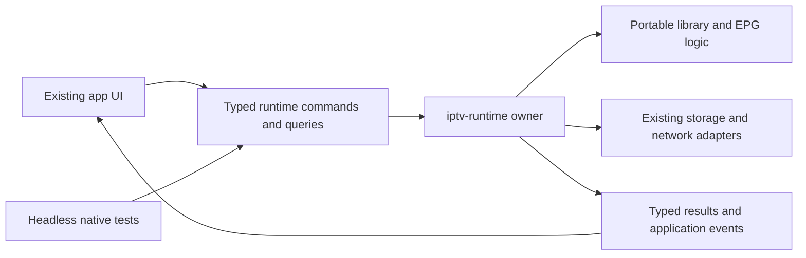
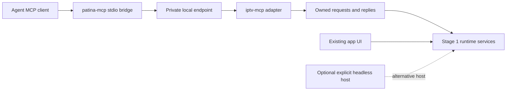

# Patina application foundation and optional MCP support

Date: 2026-11-14. Status: two-stage delivery plan, updated with API-stability gates and the application feature roadmap after the original MCP design reviews. This is planning work; the features below are not implemented by this document.

**Stage 1 delivers a useful application foundation even if MCP never ships. Stage 2 adds MCP as an optional consumer of that foundation and may be deferred indefinitely.** Completing Stage 1 does not commit the project to Stage 2.

The [original reviewed technical design](2026-11-14-mcp-design-reference.md) retains the detailed concurrency, identity, EPG, transport and security contracts. Its old M0–M6 delivery sequence is superseded by this document. Use those contracts when implementing the corresponding capability; do not treat all of its external-client infrastructure as a foundation requirement. The [review record](2026-11-14-mcp-reviews.md) distinguishes that reviewed design from this subsequent stage split.

## Baseline and stage boundary

The original design was inspected against master `5fa7a534` and an earlier
revision of [#37](https://github.com/teng-lin/patina-iptv/pull/37). The current
planning baseline is local master `5904a117a6c63bd39f9f1d518b8d0cc3d599cd06`.
The previously blocking audit I/R4 chain has merged:
[#42](https://github.com/teng-lin/patina-iptv/pull/42) at `7d83cbe`,
[#45](https://github.com/teng-lin/patina-iptv/pull/45) at `d5d3514`, and
[#48](https://github.com/teng-lin/patina-iptv/pull/48) at `0cfb764`.
The player contract (#43), localization/accessibility (#46/#47), and CI/release
work (#49/#41) are also in this baseline. Preserve their guarantees and use the
resulting validation requirements. Reconcile the actual merged API and behavior
before extending it; merge status alone does not complete F0.

### Stage 1 delivery: two PRs

The user requested one or two PRs. **Plan two PRs for all mandatory foundation
work, F0–F5.** This supersedes the earlier conversational estimate of twelve.
F0–F5 remain internal work packages and acceptance gates within these PRs.
Preparation documents, migrations, tests, UI adoption and API documentation
travel with the implementation they support; they do not require separate PRs.

| PR | Scope | Merge outcome and gate |
|---|---|---|
| 1 — Source-scoped queries and EPG inspection | F0 reconciliation and decisions; F1 channel/programme queries, identities, typed results and bounded pagination; F2 coverage audit, candidate enumeration, bounded probing/staging and schedule evidence; adopt inspection in the existing UI | The UI and an independent headless consumer inspect explicit sources through the same runtime without changing browsing/playback. FND-01–13 pass, plus relevant UI/coexistence/scale checks. The service API remains provisional until PR 2. |
| 2 — Transactional guide repair and stable foundation API | F3 preview, atomic apply, revision/publication fences, verification and conditional undo; F4 complete UI workflow, recovery and integrated scale/lifecycle validation; F5 documented internal contract v1, compatibility checks and capability matrix | Complete repair works through the app and headless consumer. FND-14–26 pass, PR 1 regressions remain green, and all F5 and repository/platform gates pass. Stage 1 is complete. |

PR 2 builds on PR 1. Start with one implementation branch for PR 1; open PR 2
against the merged result. Use coherent commits within each PR for query/domain
changes, storage/network adapters, UI adoption and tests. Keep migrations and
all their callers together. Reuse existing I/R4 coverage and implementation
instead of repeating the extraction.

PR 1 includes working read-only inspection in the existing guide-source or
assignment UI; do not merge an unused facade while deferring every caller to
PR 2. PR 2 includes the full repair UI and stability declaration. Tests accompany
each behavior change; integration validation is not postponed to a third PR.
All 26 mandatory foundation scenarios remain in scope. MCP and P1–P6 optional
feature implementations remain outside these two PRs.

If a single PR is preferred during implementation, combine these same commit
sequences and merge only after all F0–F5 gates pass. The two-PR plan provides a
useful inspection capability before repair; reducing to one does not remove
scope or checks. Further PR splitting requires a concrete implementation reason
and agreement with the user, rather than being the default delivery strategy.

### Entry checks inside PR 1

The [foundation decisions](2026-11-14-foundation-decisions.md) and
[acceptance scenarios](2026-11-14-foundation-acceptance.md) are prepared. Complete
these tasks as the first work in PR 1:

1. Record final merged ownership/service APIs, storage lifetimes and publication
   fences; resolve differences from the earlier design notes. Reconcile the
   merged player contract for the session extension decisions.
2. Establish combined-baseline evidence for the required core/wasm/app checks,
   runtime suites, scenarios, latency and affected Android/platform checks.
   Reuse valid CI evidence for the same tree; record any remaining gaps.
3. Resolve F0 decisions affecting the first implemented interface. Inventory
   existing source-explicit methods before adding new ones.
4. Begin with channel lookup/search, domain results, bounded pagination, a
   migrated UI caller and a runtime-only test consumer, then complete programme
   queries and F2 in the same PR. Contract v1 is declared only at F5 in PR 2.

These are implementation steps within PR 1, not another planning-only PR or a
reason to wait for unrelated product work.

| Concern | Stage 1: application foundation | Stage 2: optional MCP |
|---|---|---|
| Consumers | Existing UI and native headless test harness | External agents, through the same runtime |
| Runtime access | Explicit source-scoped commands/queries and typed results | Sendable request/reply bridge to the runtime owner thread |
| Identity | Existing typed source/content identities, semantic cursors and feed identity checks | Opaque wire-ID registry, persistent logical clients and connection sessions |
| EPG | Audit, candidate evidence, feed validation, preview/apply/verify/undo, exposed through the app | Tools/resources that expose those services; agent-assisted source discovery |
| Concurrency | Correct UI/background edits, cancellation, stale-result rejection and bounded work | Multi-client admission, fan-out, disconnect handling and retry receipts |
| Hosting | App-owned runtime; UI-free tests with injected ports | Local endpoint, stdio bridge and explicit standalone headless service |
| Storage | Migrations required by app queries and EPG repair | Additional wire identities, external receipt namespaces and client state |
| Permissions | App visibility/block rules and existing credential ownership | MCP scope grants, local peer authentication and transport protections |
| API stability | Documented, tested internal service contract for implemented foundation capabilities | Separately versioned wire schemas and client compatibility |
| Playback and scheduling | Settle session, programme identity, job, resource and policy boundaries; implement app features incrementally | Expose only domain capabilities actually implemented and available on the host |

Required foundation packages F0–F5 introduce no `rmcp` dependency, socket endpoint, daemon, bridge configuration, MCP permissions, external-client identity, or reconnect protocol. Headless testing means executing runtime services without NSH; it does not require shipping a headless service executable. A later DVR background host, if needed, is separately justified application work and must preserve the same single-owner storage boundary.

### Current feature status

This status is based on the inspected source at the baseline above and the corresponding R4 app paths, not a fresh real-provider playback test. Recheck it against final R4 before implementation; parsing metadata or displaying a disabled menu entry does not establish feature support.

| Capability | Current implementation | Planning consequence |
|---|---|---|
| Provider catch-up | M3U and Xtream resolution, replay from beginning and archive seeking are implemented where source metadata/provider access permits | Preserve this behavior during refactoring; improve compatibility and availability evidence |
| Stalker portal catch-up | Explicitly unsupported | Separate provider integration work, not an EPG-matching fix |
| Xtream archive-variant probing | Preferred first variant selected; probing not wired | Add bounded verification/fallback rather than equate advertised archive support with success |
| Recording / scheduled recordings | Not implemented; actions/settings are placeholders | Design durable jobs, media storage and host lifecycle before freezing related APIs |
| Reminders | Not implemented | Share scheduling and programme reconciliation concepts with recording |
| Local live-TV timeshift | No managed rewindable live buffer implemented; pause and provider archive playback are separate | Requires its own bounded buffer/storage capability |
| Movies and series experience | App navigation/settings are placeholders despite underlying provider/model support | Needs browsing, content/episode identity, resume and watched-state work |
| Parental controls | Blocked flags exist; a complete PIN/unlock feature is not implemented | Define shared policy and access checks before exposing controls broadly |

Source anchors: [playback resolution and provider limits](../../crates/iptv-guide/src/playback.rs), [archive seeking](../../crates/iptv-app/src/seek.rs), [enabled menu actions](../../crates/iptv-app/src/menu_view.rs), [future settings](../../crates/iptv-app/src/settings.rs), [navigation dispatch](../../crates/iptv-app/src/lists.rs), and [multiview's current stream accounting](../../crates/iptv-app/src/multiview.rs). The last currently assumes there are no recording consumers.

## Stage 1 — Application foundation

### Outcome and architecture

A user can inspect and repair guide coverage from Patina's own UI. Runtime services can inspect any explicitly selected source without changing the displayed playlist, focus or active player. Native tests can run the complete repair workflow without constructing a view. Errors and completion states are useful to the UI rather than inferred from side effects.

Keep `iptv-library` and `iptv-epg` portable, wasm-safe and sans IO. `iptv-runtime` owns orchestration and uses the existing storage/network ports. Views render state and issue actions. Keep the existing owner-thread/local-future model; a cross-thread service mailbox and multiple subscribers are not required merely to clean up the API.

### Foundation work packages

| Package | Deliverable | Application value | Depends on |
|---|---|---|---|
| F0 | Reconcile merged I/R4 source, finalize decisions/scenarios and preserve owner/lifecycle guarantees inside PR 1 | Establish extension boundaries before freezing contracts | Merged baseline available; complete reconciliation before F1 changes |
| F1 | Source-explicit queries, stable domain identities, typed command outcomes and bounded pagination; migrate corresponding UI callers | Search and guide inspection independent of the displayed playlist; useful failures | F0 |
| F2 | EPG coverage audit, full candidate enumeration, schedule evidence and bounded feed inspection | Explain missing/wrong guides and help choose the right entry | F1; verified G/D02 transport fix before new URL probing |
| F3 | Domain repair previews, atomic apply, publication fences, verification and conditional undo | Safe bulk guide repair, with accurate saved/effective outcomes | F2 |
| F4 | Integrate the complete workflow into the existing guide-source/assignment UI; finish headless, coexistence and scale validation | A feature users can use without an agent | F3 |
| F5 | Declare and validate internal service contract v1 for implemented foundation operations; publish capability/status and compatibility policy | A stable application API with explicit limits and regression evidence | F4 and F0 decisions resolved |

F0–F2 are completed in PR 1; F3–F5 in PR 2. Organize reviewable commits within those PRs, with tests and UI adoption accompanying the relevant services. F0 audits the merged refactoring result; extend existing services instead of repeating their extraction.

### F0 decisions required before API stabilization

Write small repository design notes for the following boundaries before F1 fixes their public shape; resolve them before F5 declares stability. Implement only abstractions consumed by current app operations. A design note for a future feature is not a placeholder implementation or a supported capability.

The initial decisions are recorded in [F0 application service decisions](2026-11-14-foundation-decisions.md).
Their [synthetic acceptance scenarios](2026-11-14-foundation-acceptance.md) separate
mandatory foundation behavior from future P1–P6 release criteria. Reconcile these
notes against the merged source; preparation alone does not complete F0.

| Boundary | Decisions and invariants to record now | Implementation boundary |
|---|---|---|
| Programme identity | A programme reference carries source/channel identity, guide provenance, observed interval and revision; use provider event IDs when available without assuming global uniqueness. Define fixed-time intent versus following an event when EPG times change. Ambiguous reconciliation never silently retargets a reminder/recording. | Used by EPG queries now; durable schedule rules arrive with reminders/DVR |
| Playback session | Identify the session separately from source/content and its generation. Describe live, provider archive, local-buffer and file/VOD playback as capabilities with different seek ranges. Results distinguish accepted command from observed playback state. | Adapt existing live/catch-up paths as needed; full browsing-independent sessions remain an app extension |
| Stream/resource allocation | Reserve network streams by actual provider/account identity, not just playlist ID, so two playlists sharing an account cannot double-spend its limit. Distinguish stream connections, decoder slots and disk/CPU capacity. Define acquire/release, cancellation, unknown limits, priorities and explicit conflict outcomes. PiP sharing consumes no extra stream; shared watching/recording transport is claimed only if implemented. | Extract policy from existing viewing/multiview consumers when useful; recording/probe consumers join the same allocator before release |
| Durable jobs and lifecycle | Separate transient refresh/inspection work from durable scheduled intent. Specify queued/scheduled/running/terminal outcomes, missed starts, retries, cancellation, restart recovery, UTC/timezone handling and host capabilities when the app closes or the device sleeps. | Reuse F3's commit/operation machinery only where semantics fit; do not build a universal scheduler ahead of a real consumer |
| Media storage | Separate the encrypted catalogue from recorded media and temporary buffer/cache data. Decide destination permissions, quotas, disk-full behavior, partial-file finalization, retention, deletion and backup treatment. Do not assume recordings are encrypted or bundled into catalogue backups. | Interface decisions now; actual media writer/storage manager with DVR or timeshift |
| Access policy | Separate hidden content from blocked content, and define whether an authorization covers search, playback, scheduling and recorded/VOD content. UI PIN unlocks and future external-client grants are distinct. | Current rules remain explicit; full PIN/parental workflows are separately implemented |

A scheduled task must identify its executing host and the behavior it can guarantee. Recording without an open app is not promised until a supported background host and platform lifecycle tests exist. If DVR later needs a persistent host without MCP, that host is an independent application extension, not a dependency on Stage 2's protocol or MCP daemon.

### F0–F1: a runtime API the app actually uses

- Pass an explicit runtime owner and source scope into services. Reads take source IDs or an explicit all-enabled scope, never the currently shown source as a hidden default. Do not move UI selection as a way to query a different playlist.
- Use `(SourceId, ContentId)` for channel identity and feed identity plus XMLTV ID for guide candidates. Preserve original identity metadata; numeric feed IDs alone are insufficient because they can be reused. Do not promise continuity when a provider rename/path change creates a new `ContentId`.
- Return typed outcomes and errors. A failed guide read is not an empty guide; a persisted mapping is not necessarily an effective binding or available programme schedule. Replace error-swallowing helpers deliberately as their UI callers migrate.
- Bound result counts, time windows, text and scan work. Use semantic keyset cursors, never SQLite rowids, FTS docids or view indices. An unchanged physical reimport must not corrupt pagination.
- Capture input revisions for background work and reject stale publication after source edits, deletion, restore or another refresh. Reuse and extend the existing import cancellation/handoff machinery rather than add a second scheduler.
- Preserve one clear storage owner and correct worker lifetime during shutdown/restore. If the process-global lock prevents isolated tests or releases ownership incorrectly, extend the existing lock with a root-keyed guard. Endpoint discovery and production multi-host ownership are Stage 2 work.
- Run expensive parsing, matching and coverage scans on bounded workers over owned snapshots. Measure contention with guide-page/UI reads. Introduce a separate background analysis reader only if this application workload needs isolation; do not add an external-query lane solely for future MCP. Any long SQL work must have effective deadlines/cancellation and bounded snapshot lifetime.
- Use existing domain events for the UI. Keep result data separate from presentation requests, without introducing a subscriber hub until there is a real second consumer.

Migrate the current UI to these services as they land. Completion is not an unused facade beside existing view-dependent orchestration.

### F5: stable internal API contract

Stage 1 promises stability only after this gate passes. Creating `iptv-runtime` or marking Rust items `pub` does not by itself establish a stable API.

**Scope:** internal Rust application-service contract v1 for the implemented library/catalogue, channel/programme query, EPG inspection/repair, and operation-status interfaces used by the UI and native test consumer. Store internals, executor implementation and UI details remain private. Playback, recording, reminders, local timeshift, VOD and full parental APIs stay explicitly experimental/unavailable until implemented and separately stabilized. This is not a binary ABI, a published SDK promise, or a network/MCP schema version.

Required contract deliverables:

- One documented public facade and DTO/error vocabulary, with source scope, identity lifetime, timestamp units, ordering/pagination, result bounds and unavailable/unsupported semantics.
- Explicit command completion semantics: accepted, durably committed, effective and verified where applicable; cancellation/deadline/shutdown behavior; event ordering, revision and snapshot recovery rules actually needed by current consumers.
- UI callers and an independent headless integration-test consumer use only the declared boundary. Architecture checks reject NSH, store/connection types, presentation indices and hidden shown-source dependencies at that boundary.
- Compile-time consumer fixtures protect selected public signatures/types. Behavioral contract tests protect errors, pagination, cancellation, restart/restore, no-op refresh, stale publication and concurrent edits. Snapshot tests alone do not establish semantic compatibility.
- Document contract v1 separately from package/release versions. Breaking signatures or behavioral semantics require a recorded compatibility revision, release/migration notes and coordinated consumer updates; use deprecation/forwarding where feasible. Do not label an added Rust enum variant, struct field or required trait method automatically nonbreaking. Tests must establish compatibility for intended consumers.
- Publish a capability matrix covering implemented, unavailable-on-this-host, unverified-provider and not-yet-implemented states. Presence of metadata, a setting or a method name is not a positive capability result. Validate capabilities with synthetic provider fixtures and available host adapters.

F5 freezes the small working boundary, not every helper or speculative future interface. F0's approved extension decisions prevent recording/session/resource requirements from being accidentally ruled out; they do not require those features to ship before the foundation can be declared stable.

### F2: EPG diagnosis and candidate inspection

Support an explicit workflow: select playlists/channels, inspect guide problems, compare candidates, and inspect programme samples before making changes.

Classify source download/import failure, missing channel metadata, unmatched identity, ambiguous identity, intentional no-guide choice, stale/partial schedule and suspicious timing separately. Report coverage over an explicit interval. Gaps or fresh programme data alone do not prove a channel identity is correct.

Enumerate candidate alternatives with evidence: full and normalized name, source-scoped IDs, original country/region/language metadata, timeshift edition, available station identity, provenance, freshness and schedule samples. Preserve `+1`/regional distinctions. Treat HD/SD equivalence as evidence to consider, not a universal equivalence. Surface the current matcher's first-entry ambiguity fallback; document order is not evidence. Return deterministic evidence categories rather than invented calibrated percentages.

Search configured feeds first. Allow the user to supply an additional feed through the existing guide-source workflow and inspect it before saving. Automated web discovery, a model, search API credentials and a bundled directory of real provider feeds are not prerequisites. An eventual agent will submit discovered candidates through the same validation service.

Existing imports retain programmes only for matched channels. Candidate inspection therefore needs bounded staging/probing when a listed guide channel has no stored schedule. Fetch through `iptv-net` with the actual G/D02 cross-origin fix and source-specific network policy; enforce redirect, resolved-address, compressed/expanded-size, XML, timeout and cancellation limits. Local synthetic tests use explicit mock-server policy. Newly supplied public locations must not become an unrestricted internal-network fetch mechanism.

Retain the inspected feed snapshot privately for later candidate queries; stage integrity, expiry, budget and encryption follow the technical reference's EPG staging contract. A stage must not change live source order or mappings. Keep stage IDs separate from durable feed IDs. Interpret supplied timestamp offsets correctly and distinguish a shifted station from a feed-wide error or display timezone; do not guess a permanent offset from one programme.

### F3: application-owned repair transactions

Repair is a product capability with persistence and UI behavior changes, not merely a code move. Its plan/result types live in the domain/runtime boundary and contain no MCP fields.

1. **Preview.** Capture selected candidates, affected channel/feed identities, evidence provenance, before/after values, protected choices, relevant revision hints, indirect automatic-match effects and expiry. Page large previews. Default a newly added feed to lowest precedence and show effects outside the explicitly edited batch.
2. **Validate and commit.** Recheck affected rows and current block/visibility rules inside the writer transaction. Protect manual assignments and intentional no-guide choices unless the user explicitly selects their replacement. Atomically save feed configuration, overrides, a domain commit ID and inverse record. Allocate new feed IDs and translate staged references in that transaction. Hold a stage lease during validation/commit. Start with a maximum of 500 explicit mapping changes per batch; measure and lower it if needed.
3. **Publish and verify.** Coalesce refresh work per source, check captured inputs before database publication and in-memory installation, and report mapping saved, effective binding, programmes available and verification state separately. Keep usable old guide data marked with its effective revision until replacement succeeds. A delayed verification never certifies newer edits.
4. **Undo.** Retain committed inverse records for seven days, including across ordinary restart. Compare affected rows with their committed after-values; preserve unrelated edits. Any affected conflict rejects the whole selected batch. Explicit out-of-batch overrides can prevent removal of a newly added feed; derived automatic matches are reported as effects instead. Undo restores configuration and may need another import; it does not promise to recover overwritten cached programmes. Restore voids old undo authority.

The store work is limited to what these app workflows need: change-based catalogue/feed/organization/mapping revisions, domain repair previews/commit outcomes/inverses and provenance. Domain commit IDs help the app reconcile accepted work; they do not require external client UUIDs, MCP idempotency namespaces or wire-ID registries.

Use guarded, column-specific triggers only for small edited tables, and one semantic-change bump in each bulk publisher/maintenance transaction. Compute the canonical catalogue digest during staging; do not add per-programme revision triggers. Inventory standalone feed edits, orphan-overlay cleanup and source enable/policy changes as well as imports. Generations invalidate dependent reads and offer a validation fast path; row preconditions determine apply/undo conflicts. A no-op refresh or unrelated edit must not reject an otherwise valid repair.

Integrate migrations and provenance with backup validation. Restore cancels/invalidates previews and active work, reopens the proper query lanes and recomputes coverage. Preserve ordinary import identity semantics; do not silently carry an override onto a different stream. UI optimistic/queued writes must join the same ordering and publication rules rather than overwrite a newer commit afterward.

### F4–F5: UI integration and foundation acceptance

Extend the existing guide-source and guide-assignment flows to show coverage problems, alternatives with evidence, a reviewable change summary, progress, saved-versus-effective results and undo. An unresolved candidate stays unresolved; the user can continue using the existing guide. Reuse the original Patina design and existing focus-by-content-identity rules.

Stage 1 is complete when:

- The app can run **audit → inspect configured/new feed → compare candidates → preview → apply → verify → undo** for synthetic channels through runtime services.
- The same sequence runs in native headless tests using injected storage/network/clock ports, without NSH, a view, a player or an MCP server.
- Querying or repairing another source leaves the displayed playlist, focus and playback intact. Refresh, source deletion and restore cannot publish stale results over a newer edit.
- Missing data, failed reads, mapping persistence and effective guide availability have distinct outcomes visible to the user.
- No-op refresh between preview/apply succeeds; unrelated edits between commit/undo survive; an affected conflict rejects the whole batch.
- F0's programme/session/job/resource/storage/policy decisions are recorded, and F5's documented contract v1, compatibility policy, independent-consumer tests and capability matrix pass. Deferred features remain accurately unavailable or experimental.
- The implementation has no MCP transport/SDK/configuration dependency, and stopping here leaves a complete application feature rather than an unused service layer.

Required evidence includes portable matcher/coverage tests; typed error paths; identity and pagination across replace-all imports; staged-feed budgets and cancellation; source/config/undo races; stage eviction/expiry; schema/backup/restore behavior; UI scenarios and synthetic 100,000-channel scale measurements. Preserve existing input-latency and reader/writer separation gates. Run the repository checks listed below.

### Application feature roadmap, independent of MCP

The following workstreams remain within the application side of this two-stage plan and can ship before or after MCP. Their architecture must be considered in F0; their complete implementations are not F5 prerequisites. There is no third mandatory delivery stage and no commitment to a full DVR/VOD product in the foundation release.

| Workstream | Scope to plan now | Dependency and release evidence |
|---|---|---|
| P1 — Catch-up compatibility | Stalker portal archive support; Xtream variant verification/fallback; advertised versus verified availability; archive windows, provider clock and seek/recovery behavior | Source-explicit playback/capability contracts and shared connection budgets for active probes; synthetic protocol cases and end-to-end replay tests; no regression to current M3U/Xtream replay |
| P2 — Sessions and shared resources | Runtime-owned session identity, explicit stream/decoder leases, account-wide accounting across playlists, conflict handling and playback independent of browsing where desired | Existing UI/live/catch-up/multiview callers adopt the service; test no duplicate streams on retry, lease release on cancellation/failure, and preserved surfaces/PiP. Required before multiple independent recording/viewing consumers ship |
| P3 — Reminders and DVR | Durable one-off reminders and record-now/scheduled recording, followed by recurring/series rules; EPG corrections, padding, missed starts, conflicts, restart recovery and destination/storage management | F0 job/programme/storage decisions and P2 allocation; recorder writes media independently of the rendered player; test device/app lifecycle, partial recordings, disk-full, cancellation, retries and retained schedules |
| P4 — Local timeshift | A bounded rewindable live buffer, retained seek window, pause/resume/live-edge behavior, eviction and interaction with recordings | P2 sessions/resource leases and a media storage manager; validate disk caps, seek bounds, eviction while playing, source changes and failure cleanup. Provider catch-up is not evidence this feature exists |
| P5 — Movies and series | Catalogue/category browsing, movie/series/episode identities, playback resolution, resume position, watched state and next-episode behavior | Content identities, playback/session capabilities and persistence policy; provider parsing alone is not completion; require UI and headless workflow tests |
| P6 — Parental controls | PIN setup/unlock/reset, scoped grants, expiry, blocked metadata/search/playback/scheduling, and recorded/VOD content policy | A shared runtime access decision used by every applicable entry point; hiding remains separate; future MCP cannot inherit UI unlock or bypass the check with a known ID |

Plan P2 and P3's lifecycle/resource contracts first because they most affect API shape. After the core foundation, implement P1 compatibility improvements and P2 as measured app improvements; reminders and incremental DVR can then share the agreed scheduling model. Local timeshift follows established session/media-storage behavior. VOD and parental controls are independently prioritized product work, with their dependencies explicit rather than coupled to MCP delivery.

For P3, specify support per host: reject unsupported closed-app scheduling or clearly offer app-running-only behavior; do not silently promise execution when the host cannot wake/run. Recordings persist their own immutable job ID, selected content/programme reference, schedule policy and observed outcome. An ambiguous EPG update requires review instead of recording an unrelated programme. A renderer must never be kept hidden or detached just to make recording work.

For P4, define whether recording and the live buffer share an underlying fetch. Until such fan-out is implemented and tested, account for their actual separate network use. Raw recording need not reserve a decoder; transcoding must declare its additional resource requirements. These details belong in the shared allocator rather than separate feature-specific counters.

### Other optional application extensions

These are independent product choices, not gates for the foundation release above:

- **Playback details for P2.** Move authoritative `(SourceId, ContentId, generation)` session identity into the runtime, adapt UI zap/history/resume, and introduce a toolkit-independent player command/result port. R4's typed player events alone do not provide this. Preserve one persistent surface, PiP sharing, explicit multiview targets and provider connection budgets. Browsing independence is an intentional behavior change with real-player and Android validation.
- **Library organization preview/undo.** Reuse the repair transaction pattern for favorites/visibility/groups if the app needs bulk organization. Integrate the existing queued favorite writer before exposing atomic plans; do not add SQL mutations behind optimistic UI state.
- **Guide drift reporting.** Re-run coverage checks after ordinary refresh, reporting deterioration without silently replacing manual choices.

If these implementations are deferred, Stage 1 can still ship after F5. Stage 2 must expose only capabilities actually implemented; it cannot advertise playback, recording, timeshift or bulk-organization tools merely because they appear in this roadmap.

## Stage 2 — Optional MCP support

### Entry gate and architecture

Begin only after Stage 1 has shipped or passed its acceptance gates **and** there is a concrete decision to support external agents. Deferring or cancelling this stage leaves Stage 1 complete. Revalidate SDK/protocol/client versions, the final runtime API and platform packaging when this stage is scheduled; the original protocol choices are design references, not a reason to pin dependencies now.

The MCP adapter translates wire schemas and enforces external-client policy. Domain queries, matching, repair and playback behavior remain in the foundation. An agent alongside the app attaches to its runtime owner; a bridge never opens a competing database/runtime. The standalone service is an explicit alternative host, not a prerequisite for the app feature.

### MCP work packages

| Package | Deliverable | Depends on | Acceptance |
|---|---|---|---|
| C0 | Confirm external workflows, protocol/client compatibility and wire schemas; review declared Stage 1 contract v1 and capability matrix | F5 and decision to start Stage 2 | Each planned tool maps to an implemented, compatible domain capability |
| C1 | Runtime mailbox, bounded external reads, sanitized subscriber fan-out, opaque wire identities and external operation/receipt namespaces | C0 | Multiple clients cannot starve the UI; lost replies can be reconciled without duplicate mutations |
| C2 | `iptv-mcp`, stdio bridge, app-hosted private endpoint, scope configuration and peer authentication | C1 | Agent alongside the app uses the existing owner and never depends on a view |
| C3 | Discovery/diagnostic/EPG tool schemas, resources and optional workflow prompts | C2 + F1–F5 | An independent client completes guide repair using the Stage 1 implementation |
| C4 | Explicit standalone `patina-service` or adapter on an existing app background host, shared native credential ports and host packaging | C2; may run alongside C3 | Same library and services without NSH; clear lock/key failures; reuse an existing DVR host if present rather than create a second owner |
| C5 | Tools for completed optional app capabilities, starting with playback/organization | C3 + the relevant implemented and separately stabilized app API | Control the existing session or feature through its domain policy; define any later recording/reminder/VOD schemas only after those services exist |

An app-hosted MCP release can ship after C3; standalone headless operation additionally needs C4. Neither release waits for C5 capabilities the app does not yet support. Remote HTTP/LAN access, cross-device deployment and seamless owner handoff remain separately scoped future options within this stage, rather than prerequisites for local MCP.

### External-client additions

- Add a sendable request/reply handle containing only channels and owned DTOs. Dispatch local futures on the existing runtime owner thread; preserve owner context across suspension and do not make `Rc`/`RefCell` state artificially `Send`.
- Protect UI responsiveness under real agent workloads with bounded queues, effective SQL cancellation, a runtime-owned external reader lane where needed, and slow-subscriber invalidation/reload behavior. Reuse any analysis isolation established by Stage 1 rather than add duplicate infrastructure.
- Add opaque external IDs without exposing credential-bearing provider identifiers. Keep their registry independent of replace-all rowids/cascades, including configured-feed incarnations and staged-candidate translation.
- Distinguish persistent logical client identity, connection/session identity and owner epoch. Persist external idempotency receipts keyed by client/request plus payload hash; recover a lost response across bridge restart before attempting a mutation again. Reuse domain commit/inverse records from F3.
- Expose scopes, blocked-content rules and tool/resource policy at the service boundary. MCP cannot grant itself access or inherit a future UI unlock implicitly. Keep scope configuration outside restored data so a backup cannot broaden grants.
- Add local socket/named-pipe discovery, peer verification and bounded framing. Standard stdio remains the client-facing transport. The bridge attaches to an existing owner by default and never starts a second owner on an ambiguous connection failure.
- For C4, extend the existing profile lock/lifecycle as necessary and extract native broker support only when the second production host needs it. Use the same default directory and credential item. Headless key access is noninteractive; no new-key or plaintext fallback. Treat Linux, Windows and signed macOS host support as individually validated capabilities.
- Make app-hosted MCP a desktop-only optional feature. No endpoint or SDK dependency is introduced into portable core crates or mobile builds by default.

The technical reference's §§3–6 and §9 specify the detailed hosting, identity, grants, job/error, protocol and resource-limit contracts. Apply its §7 domain EPG guarantees already established in Stage 1; do not reimplement them in tool handlers.

### Tool groups and release boundaries

| Group | Planned tools | Foundation requirement |
|---|---|---|
| Discovery and status | `runtime_status`, `library_sources`, `channel_search`, `channel_get`, `programme_search`, `channel_schedule` | F1 |
| EPG inspection | `epg_audit`, `epg_sources`, `epg_candidates`, `epg_source_probe`, `epg_candidate_schedule` | F2 |
| EPG repair | `epg_plan_create/get/apply/undo`, `epg_verify`, `source_refresh`, `operation_get/cancel` | F3–F4 plus C1's external request lifecycle |
| Playback | `playback_status`, `playback_play`, `playback_control`, `playback_diagnose` | Completed playback-session foundation and available player |
| Library organization | `library_plan_create/get/apply/undo` | Completed application bulk-organization capability |

Slash notation above groups separate tool names; it is not a generic action-dispatch API. Each tool gets a narrow input/output schema, policy requirement, bounded result and typed error. Advertise implemented and permitted capabilities accurately; return unavailable/unsupported honestly when a host has no player or a domain feature is absent.

MCP protocol negotiation and Patina tool-schema compatibility are separate contracts from the internal Rust service API. At C0, document supported protocol/client versions, tool-schema versioning and deprecation behavior, and add wire contract tests. Do not expose a speculative recording endpoint to reserve its name. Once P3/P4/P5/P6 are implemented, design their tools against their proven domain capabilities and host policy.

The agent can use its own search tools to discover candidate EPG sources, then submit them through the shared probe service. MCP requires no embedded model, browser, source catalogue, sampling or elicitation for these workflows.

Stage 2 acceptance adds protocol/version/schema tests, stdio cleanliness, two agents alongside the UI, reconnect and lost-response recovery, grant/redaction checks, local endpoint permission tests, credential/lock/startup races and signed-platform packaging. Run native-agent, Claude CLI and agy CLI smoke workflows against synthetic data with recorded client versions. If C4 ships, run the same EPG workflow in both app-hosted and standalone modes. C5 requires existing-session playback acknowledgement and real-player/surface checks, not just an accepted command.

## Validation and stopping rule

For implementation in either stage, follow `AGENTS.md`: synthetic fixtures/local mock servers only, portable core builds for wasm, identity-based focus and persistent player-surface rules. Run `cargo test -p iptv-core`, `cargo build -p iptv-core --target wasm32-unknown-unknown`, `cargo build -p iptv-app`, affected package/scenario tests and the milestone's full `tools/check.sh`. Android changes require `tab36` and/or `tv36`; cross-platform adapter changes require their platform CI. Test actual concurrency/behavior requirements rather than creating tests that merely mirror wrappers.

**The Stage 1 stopping point is a shipped EPG app workflow, UI-free runtime tests and declared internal service contract v1 after F5.** The programme/session/job/resource/storage/policy design decisions must be settled; full DVR, reminders, local timeshift, VOD and parental implementations may remain separately scheduled. Stage 1 is successful even if Stage 2 is never scheduled. External clients, transport compatibility, a new standalone executable and MCP-specific persistence are not criteria for declaring the foundation complete.

The [reviewed design reference](2026-11-14-mcp-design-reference.md) and [historical review log](2026-11-14-mcp-reviews.md) preserve the earlier analysis and evidence. Their technical findings remain inputs; this document is the authoritative delivery sequence.
